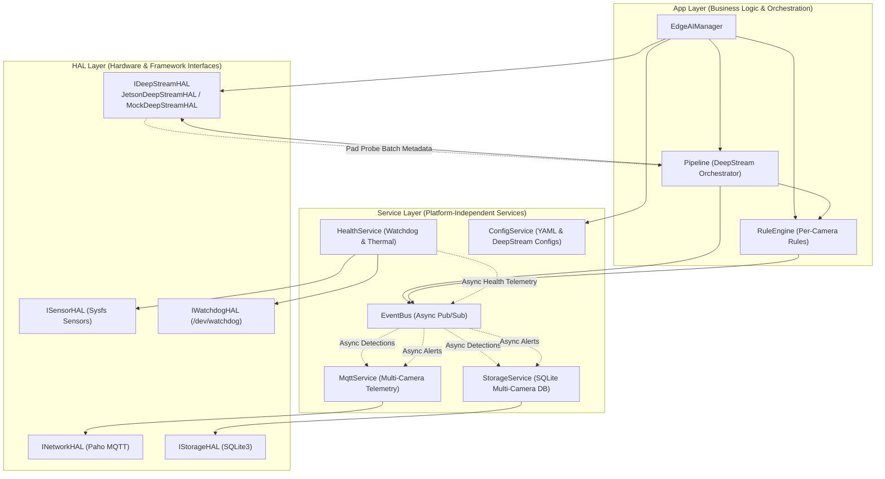

# High-Level Design Document (HLD)
## Project: Multi-Camera Edge AI Video Analytics on Jetson with NVIDIA DeepStream SDK

---

## 1. Module Overview & Responsibilities

| Module | Tier | Responsibility | Primary Interactions |
|---|---|---|---|
| **EdgeAIManager** | App | System lifecycle, multi-camera dependency injection, signal handling, graceful shutdown | Owns HAL and Service instances, wires pad probe callbacks |
| **Pipeline** | App | Orchestrates DeepStream pipeline execution, frame stepping, and latency/FPS aggregation | Interfaces with `IDeepStreamHAL`, invokes rule evaluation per camera |
| **RuleEngine** | App | Evaluates business rules (zone intrusion, line counting) with per-camera isolation | Receives tracked objects tagged with `camera_id`, generates alerts to `EventBus` |
| **IDeepStreamHAL** | HAL | Pure virtual interface abstracting multi-camera GStreamer/DeepStream pipeline | Implemented by `JetsonDeepStreamHAL` and `MockDeepStreamHAL` |
| **JetsonDeepStreamHAL** | HAL | Production hardware pipeline: `nvstreammux` batching, `nvinfer`, `nvtracker`, pad probe | Interacts with NVIDIA driver, NVMM memory, and GStreamer plugins |
| **MockDeepStreamHAL** | HAL | Simulates concurrent multi-camera video streams and detections on Host PC | Used for 100% test coverage and CI without Jetson hardware |
| **EventBus** | Service | In-process, lock-free/non-blocking asynchronous Pub/Sub event dispatcher | Decouples video analytics pipeline from MQTT network and SQLite disk I/O |
| **MqttService** | Service | Asynchronous telemetry publisher with per-camera topic routing and offline queue | Subscribes to `EventBus`, publishes JSON payloads with `camera_id` |
| **StorageService** | Service | Local embedded database persistence with multi-camera schema and batch transactions | Subscribes to `EventBus`, writes detections and alerts to SQLite |
| **HealthService** | Service | Periodic thermal monitoring, CPU/GPU load measurement, hardware watchdog keepalive | Interacts with `/dev/watchdog` and sysfs thermal zones |
| **ConfigService** | Service | Parses and validates `app_config.yaml`, `rules.yaml`, and DeepStream property files | Injected into all services and HALs during initialization |

---

## 2. High-Level Subsystem Interactions

---

## 3. Communication Patterns

### 3.1 Asynchronous GStreamer Pad Probe Callback
* DeepStream runs asynchronously within native hardware GStreamer streaming threads.
* A buffer probe (`GST_PAD_PROBE_TYPE_BUFFER`) attached to the `nvtracker` source pad intercepts batched metadata `NvDsBatchMeta`.
* For each frame in the batch:
  1. The probe maps `frame_meta->source_id` to `camera_id` (e.g. `source_id = 0` $\to$ `cam_01`).
  2. Detections and track IDs are extracted into a C++ `PipelineResult`.
  3. The probe calls `Pipeline::onDeepStreamMetadata()`, which evaluates rules for that specific camera and publishes the result to `EventBus`.
* Execution is zero-copy with respect to video frame memory.

### 3.2 Non-Blocking Event Bus Distribution
* Thread 1 or the probe thread spends $< 0.05\text{ ms}$ pushing events to the thread-safe `EventBus` queue.
* The `EventBus` worker thread delivers events to subscribers (`MqttService` and `StorageService`) asynchronously.
* Neither network jitter nor disk I/O ever stalls video analytics or drops camera frames.

### 3.3 Periodic Hardware Monitoring & Watchdog
* `HealthService` executes every 30 seconds on a dedicated timer thread:
  1. Reads CPU/GPU utilization and core temperatures.
  2. Kicks Linux kernel `/dev/watchdog` via `ioctl(fd, WDIOC_KEEPALIVE, 0)`.
  3. Publishes `HealthStatus` telemetry to `EventBus`.
