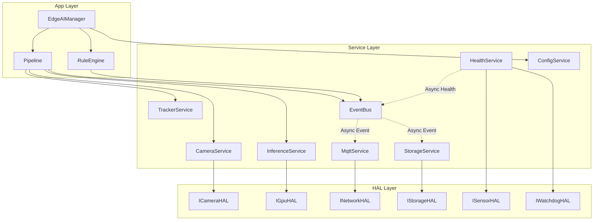

# High-Level Design Document (HLD)
## Project: Embedded AI Object Detection on Jetson Nano 4GB (Yocto Linux)

---

## 1. Module Overview & Responsibilities

| Module | Tier | Responsibility | Primary Interactions |
|---|---|---|---|
| **EdgeAIManager** | App | System lifecycle, initialization, graceful shutdown, signal handling | Owns all services and HAL instances |
| **Pipeline** | App | Per-frame synchronous flow: Capture -> Infer -> Track | Calls CameraService, InferenceService, TrackerService |
| **RuleEngine** | App | Evaluates business rules (zone intrusion, line counting) | Receives tracked objects, publishes alerts to EventBus |
| **CameraService** | Service | Dedicated frame capture thread, ring buffering, drop policy | Wraps `ICameraHAL`, feeds Pipeline |
| **InferenceService** | Service | YOLOv8 pipeline: Letterbox resize, normalize, NMS | Wraps `IGpuHAL`, converts `Frame` to `Detection` vector |
| **TrackerService** | Service | Multi-object tracking (ByteTrack): assigns persistent track IDs | Pure C++ algorithm (Kalman Filter + Hungarian) |
| **EventBus** | Service | In-process, multi-threaded asynchronous Pub/Sub dispatcher | Decouples Pipeline from MQTT and SQLite |
| **MqttService** | Service | Asynchronous telemetry publishing, offline queue, reconnect | Wraps `INetworkHAL`, subscribes to EventBus |
| **StorageService** | Service | Batch writing detection & alert records to local SQLite ring buffer | Wraps `IStorageHAL`, subscribes to EventBus |
| **HealthService** | Service | Periodic thermal monitoring, RAM/CPU stats, hardware watchdog keepalive | Wraps `ISensorHAL` & `IWatchdogHAL` |
| **ConfigService** | Service | Loading, schema validation, and serving YAML configuration | Used by EdgeAIManager |

---

## 2. High-Level Subsystem Interactions

---

## 3. Communication Patterns

1. **Synchronous Direct Method Call**:
   * Used strictly inside the time-critical frame processing pipeline:
   * `Pipeline::processOneFrame()` -> `CameraService::grabFrame()` -> `InferenceService::detect()` -> `TrackerService::update()`.
   * Execution time: deterministic, strictly bounded (~50ms total).

2. **Asynchronous Decoupled Event Publishing**:
   * Used for all telemetry, persistence, and external logging:
   * `Pipeline` publishes `EventType::TRACKED_OBJECTS` to `EventBus` (takes < 0.02ms).
   * `EventBus` dispatch thread distributes the event to `MqttService` and `StorageService` without slowing down the next camera frame.

3. **Periodic Daemon Tasks**:
   * `HealthService` executes on an independent timer thread every 30 seconds.
   * Reads sensor temperatures, CPU/GPU utilization, and writes to `/dev/watchdog`.

