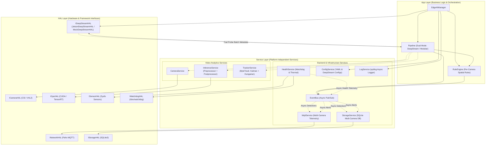

# High-Level Design Document (HLD)
## Project: Multi-Camera Edge AI Video Analytics on Jetson with NVIDIA DeepStream SDK

---

## 1. Module Overview & Responsibilities

The system is decomposed into 3 distinct architectural tiers (Application, Service, and Hardware Abstraction Layer):

| Module | Tier | Responsibility | Primary Interactions |
|---|---|---|---|
| **EdgeAIManager** | App | System lifecycle, dependency injection, service instantiation, and graceful shutdown | Owns all Service and HAL instances; routes DeepStream metadata callbacks |
| **Pipeline** | App | Coordinates video analytics pipeline execution, supporting both DeepStream hardware mode and modular service mode | Interfaces with `IDeepStreamHAL` or `CameraService` + `InferenceService` + `TrackerService` |
| **RuleEngine** | App | Evaluates spatial business rules (`ZoneRule`, `CountingRule`) with per-camera channel isolation | Receives tracked objects tagged with `camera_id`; publishes alerts to `EventBus` |
| **CameraService** | Service | Manages camera capture lifecycle, frame buffer retrieval, reconnect logic, and resolution setting | Wraps `ICameraHAL`; delivers frames in modular/fallback mode |
| **InferenceService** | Service | Coordinates deep learning model inference, input scaling, GPU execution, and tensor parsing | Wraps `IGpuHAL`, `Preprocessor`, and `Postprocessor` |
| **TrackerService** | Service | Multi-object tracking (ByteTrack algorithm) maintaining persistent object trajectories across frames | Employs `KalmanFilter` for motion prediction and `Hungarian` for bipartite matching |
| **Preprocessor** | Service | Hardware-friendly input preprocessing: letterbox aspect-ratio padding, BGR-to-RGB, normalization ($1/255$), and CHW layout | Called by `InferenceService` before GPU inference |
| **Postprocessor** | Service | Decodes raw YOLOv8 `(1, 84, 8400)` output tensors: score filtering, class argmax, coordinate unletterboxing, and NMS | Called by `InferenceService` after GPU inference |
| **EventBus** | Service | In-process, non-blocking asynchronous Pub/Sub event dispatcher | Decouples video pipeline from MQTT network and SQLite disk I/O |
| **MqttService** | Service | Asynchronous telemetry & alert publisher with per-camera topic routing and offline queue | Subscribes to `EventBus`, publishes JSON payloads via `INetworkHAL` |
| **StorageService** | Service | Embedded database persistence with multi-camera schema and batched SQLite transactions | Subscribes to `EventBus`, writes detections and alerts via `IStorageHAL` |
| **HealthService** | Service | Periodic thermal monitoring, CPU/GPU load measurement, and hardware watchdog keepalive | Interacts with `ISensorHAL` (sysfs) and `IWatchdogHAL` (`/dev/watchdog`) |
| **ConfigService** | Service | Parses and validates `app_config.yaml`, `rules.yaml`, and DeepStream property files | Injected into all services and HALs during system initialization |
| **LogService** | Service | Centralized thread-safe asynchronous structured logging (`spdlog`) | Sinks to stdout, rotating log files, and systemd journal |
| **IDeepStreamHAL** | HAL | Pure virtual interface abstracting multi-camera GStreamer/DeepStream pipeline | Implemented by `JetsonDeepStreamHAL` and `MockDeepStreamHAL` |
| **JetsonDeepStreamHAL** | HAL | Production hardware pipeline: `nvstreammux` batching, `nvinfer`, `nvtracker`, `nvmultistreamtiler`, pad probe | Interacts with NVIDIA driver, NVMM memory, and GStreamer plugins |
| **MockDeepStreamHAL** | HAL | Simulates concurrent multi-camera video streams and detections on Host PC | Used for 100% test coverage and CI without Jetson hardware |
| **ICameraHAL** | HAL | Physical camera capture abstraction (MIPI CSI-2 via Argus or USB V4L2) | Implemented by `JetsonCameraHAL` and `MockCameraHAL` |
| **IGpuHAL** | HAL | CUDA runtime and TensorRT execution context abstraction | Implemented by `JetsonGpuHAL` and `MockGpuHAL` |
| **INetworkHAL** | HAL | Network communication and MQTT transport abstraction | Implemented by `JetsonNetworkHAL` (Paho) and `MockNetworkHAL` |
| **IStorageHAL** | HAL | Local database storage abstraction (SQLite3) | Implemented by `JetsonStorageHAL` and `MockStorageHAL` |
| **ISensorHAL** | HAL | System hardware telemetry abstraction (SoC thermal zones, CPU/GPU load) | Implemented by `JetsonSensorHAL` and `MockSensorHAL` |
| **IWatchdogHAL** | HAL | Hardware watchdog timer abstraction (`/dev/watchdog`) | Implemented by `JetsonWatchdogHAL` and `MockWatchdogHAL` |

---

## 2. High-Level Subsystem Interactions

---

## 3. Communication Patterns

### 3.1 Primary Path: Asynchronous DeepStream Pad Probe Callback
1. DeepStream executes natively in hardware GStreamer streaming threads (zero-copy NVMM memory).
2. A buffer probe (`GST_PAD_PROBE_TYPE_BUFFER`) on the `nvtracker` source pad intercepts `NvDsBatchMeta`.
3. For each frame in the batch:
   * Maps `frame_meta->source_id` to the corresponding `camera_id` (e.g. `0` $\to$ `cam_01`, `1` $\to$ `cam_02`).
   * Extracts detections, labels, and tracking IDs into a `PipelineResult`.
   * Invokes `Pipeline::onDeepStreamMetadata()`, which evaluates rules per camera and dispatches events to `EventBus`.

### 3.2 Modular Fallback Path: Service-Level Pipeline
When running in diagnostic or single-camera mode without DeepStream:
1. `CameraService` grabs a `cv::Mat` frame from `ICameraHAL`.
2. `InferenceService` uses `Preprocessor` to letterbox and normalize the frame, runs GPU inference via `IGpuHAL`, and parses bounding boxes via `Postprocessor`.
3. `TrackerService` updates Kalman trajectories and performs Hungarian association.
4. Results are pushed to `RuleEngine` and published to `EventBus`.

### 3.3 Non-Blocking Event Bus Distribution
* The probe thread or pipeline worker spends $< 0.05\text{ ms}$ pushing events into the thread-safe `EventBus` queue.
* Dedicated worker threads deliver events to `MqttService` and `StorageService` asynchronously.
* Neither network latency nor disk writes ever block frame processing or cause dropped video frames.

### 3.4 Periodic Hardware Monitoring & Watchdog
* `HealthService` executes every 30 seconds on a timer thread:
  1. Inspects SoC thermal zones and CPU/GPU utilization via `ISensorHAL`.
  2. Kicks Linux kernel `/dev/watchdog` via `IWatchdogHAL` (`ioctl(fd, WDIOC_KEEPALIVE, 0)`).
  3. Publishes `HealthStatus` events to `EventBus`.
