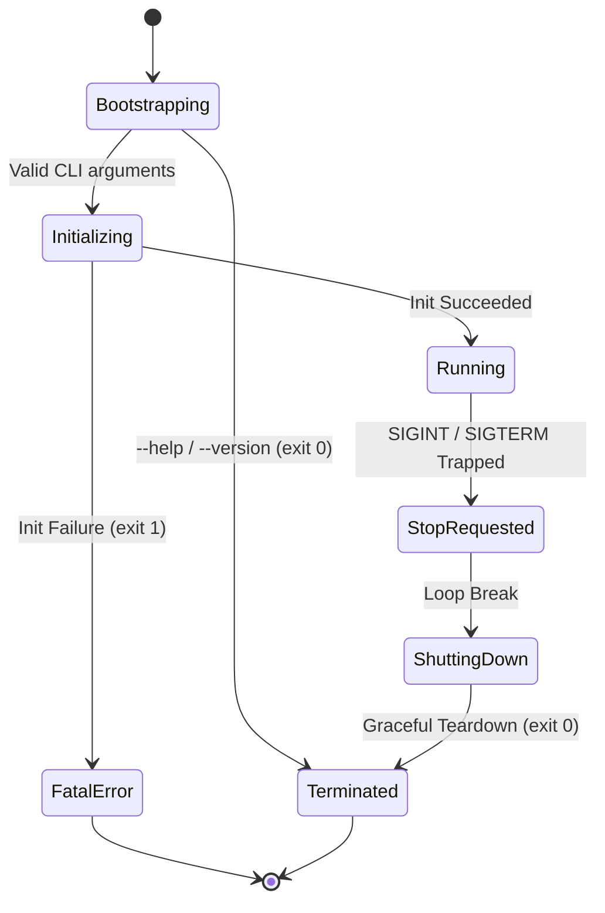

# Software Design Document (SWDD)
## Project: Multi-Camera Edge AI Video Analytics on Jetson with NVIDIA DeepStream SDK

---

## 1. Package Structure & Modular Decomposition

The project source code is arranged into 3 clean architectural tiers with strict separation of concerns:

```
src/
├── app/                  # Tier 1: Application Layer (Business Logic & Orchestration)
│   ├── main.cpp          # CLI entry point, argument parsing, POSIX signals
│   ├── edge_ai_manager   # Master orchestrator & Dependency Injection container
│   ├── pipeline          # Dual-mode pipeline coordinator (DeepStream / Modular Services)
│   ├── rule_engine       # Multi-Camera domain detection and counting engine
│   └── rules/            # Concrete rules: zone_rule, counting_rule
│
├── service/              # Tier 2: Service Layer (Platform-Independent Services)
│   ├── camera_service    # Video capture lifecycle & frame acquisition (wraps ICameraHAL)
│   ├── inference_service # Deep learning inference pipeline (wraps IGpuHAL + Pre/Post)
│   ├── tracker_service   # ByteTrack multi-object tracking (KalmanFilter + Hungarian)
│   ├── preprocessor      # Aspect-ratio preserving letterbox, RGB conversion, normalization
│   ├── postprocessor     # YOLOv8 tensor parsing (1, 84, 8400), NMS, un-letterboxing
│   ├── kalman_filter     # 8D state vector Kalman Filter for bounding box tracking
│   ├── hungarian         # Munkres/Hungarian bipartite matching algorithm
│   ├── event_bus         # In-process lock-free asynchronous Pub/Sub dispatcher
│   ├── mqtt_service      # Multi-camera telemetry & alert publishing (wraps INetworkHAL)
│   ├── storage_service   # SQLite ring buffer persistence (wraps IStorageHAL)
│   ├── health_service    # Watchdog keepalive & thermal monitor (wraps ISensorHAL, IWatchdogHAL)
│   ├── config_service    # YAML loader & DeepStream config validator
│   └── log_service       # Asynchronous thread-safe structured logger (spdlog)
│
└── hal/                  # Tier 3: Hardware Abstraction Layer (Target Drivers & Mocks)
    ├── jetson/           # Concrete Jetson implementations
    │   ├── jetson_deepstream_hal.cpp (nvstreammux, nvinfer, nvtracker, pad probe)
    │   ├── jetson_camera_hal.cpp     (Hardware CSI nvarguscamerasrc / V4L2)
    │   ├── jetson_gpu_hal.cpp        (CUDA runtime & TensorRT engine context)
    │   ├── jetson_network_hal.cpp    (Paho MQTT C library)
    │   ├── jetson_storage_hal.cpp    (SQLite3 C API)
    │   ├── jetson_sensor_hal.cpp     (Linux /sys thermal zones & CPU/GPU load)
    │   └── jetson_watchdog_hal.cpp   (Linux /dev/watchdog ioctl)
    └── mock/             # Mock HALs for 100% Host PC Unit Testing without hardware
        ├── mock_deepstream_hal.h     (Concurrent multi-camera simulation)
        ├── mock_camera_hal.h         (Synthetic frame generator)
        ├── mock_gpu_hal.h            (Synthetic bounding box generator)
        ├── mock_network_hal.h        (In-memory message capture)
        ├── mock_storage_hal.h        (In-memory key/value store)
        ├── mock_sensor_hal.h         (Simulated thermal metrics)
        └── mock_watchdog_hal.h       (Watchdog kick recorder)
```

---

## 2. Application Entry Point & CLI Specification (`main.cpp`)

The system entry point is located in `src/app/main.cpp`. It acts as the process bootstrapper, command-line interface (CLI) parser, POSIX signal trap handler, and runtime lifecycle controller:

```cpp
int main(int argc, char* argv[]) {
    std::string config_path = "config/app_config.yaml";
    bool use_mock_hal = false;

    // 1. Parse Command-Line Options
    for (int i = 1; i < argc; ++i) {
        std::string arg = argv[i];
        if ((arg == "--config" || arg == "-c") && i + 1 < argc) {
            config_path = argv[++i];
        } else if (arg == "--mock" || arg == "-m") {
            use_mock_hal = true;
        } else if (arg == "--help" || arg == "-h") {
            printUsage();
            return 0;
        } else if (arg == "--version" || arg == "-v") {
            printVersion();
            return 0;
        }
    }

    // 2. Install POSIX Signal Handlers
    std::signal(SIGINT,  edge_ai::EdgeAIManager::signalHandler);
    std::signal(SIGTERM, edge_ai::EdgeAIManager::signalHandler);

    // 3. Instantiate Application Orchestrator on Stack (RAII)
    edge_ai::EdgeAIManager app;

    // 4. Initialize Subsystems & Services
    if (!app.initialize(config_path, use_mock_hal)) {
        std::cerr << "[Fatal Error] EdgeAIManager failed to initialize.\n";
        return 1;
    }

    // 5. Enter Multi-Camera Processing Loop
    app.run();

    // 6. Execute Deterministic Graceful Teardown
    app.shutdown();

    return 0;
}
```

### 2.1 CLI Arguments Reference

| Option | Long Option | Argument | Default Value | Description |
|---|---|---|---|---|
| `-c` | `--config` | `<file_path>` | `config/app_config.yaml` | Path to master YAML application configuration file |
| `-m` | `--mock` | None | `false` | Run in Host PC Simulation mode using `MockDeepStreamHAL` without physical Jetson GPU/CSI hardware |
| `-h` | `--help` | None | - | Display command-line usage syntax and exit with code `0` |
| `-v` | `--version` | None | - | Display application release version (`edge-ai-manager v1.0.0`) and exit with code `0` |

### 2.2 POSIX Signal Handling Architecture
* **Signals Trapped**: `SIGINT` (Terminal interrupt `Ctrl+C`) and `SIGTERM` (Termination request sent by `systemd` daemon upon `systemctl stop`).
* **Atomic Flag (`stop_requested`)**: `EdgeAIManager::signalHandler()` writes to `std::atomic<bool> EdgeAIManager::stop_requested{true}`. This guarantees signal-safety (no memory allocation or mutex locking inside the signal handler context).
* **Process Exit Codes**:
  * `0`: Clean shutdown following graceful termination of all services.
  * `1`: Fatal error during initialization (e.g. malformed YAML config, missing CSI sensor, or GStreamer pipeline failure).

### 2.3 Process Lifecycle State Machine



---

## 3. Dependency Injection & Object Lifecycle

All dependencies are instantiated in `EdgeAIManager::initialize()` and injected via constructor references, completely avoiding global state or singletons:

```cpp
bool EdgeAIManager::initialize(const std::string& config_file, bool use_mock_hal) {
    // 1. Load Configuration
    config_ = std::make_unique<ConfigService>();
    if (!config_->loadFromFile(config_file)) return false;

    // 2. Initialize Centralized Logger
    LogService::init(config_->getLogLevel(), config_->getLogFile());

    // 3. Instantiate HALs (Jetson Production vs. Mock Host Mode)
    if (use_mock_hal) {
        deepstream_hal_ = std::make_unique<hal::MockDeepStreamHAL>();
        camera_hal_     = std::make_unique<hal::MockCameraHAL>();
        gpu_hal_        = std::make_unique<hal::MockGpuHAL>();
        network_hal_    = std::make_unique<hal::MockNetworkHAL>();
        storage_hal_    = std::make_unique<hal::MockStorageHAL>();
        sensor_hal_     = std::make_unique<hal::MockSensorHAL>();
        watchdog_hal_   = std::make_unique<hal::MockWatchdogHAL>();
    } else {
        deepstream_hal_ = std::make_unique<hal::JetsonDeepStreamHAL>();
        camera_hal_     = std::make_unique<hal::JetsonCameraHAL>();
        gpu_hal_        = std::make_unique<hal::JetsonGpuHAL>();
        network_hal_    = std::make_unique<hal::JetsonNetworkHAL>();
        storage_hal_    = std::make_unique<hal::JetsonStorageHAL>();
        sensor_hal_     = std::make_unique<hal::JetsonSensorHAL>();
        watchdog_hal_   = std::make_unique<hal::JetsonWatchdogHAL>();
    }

    // 4. Instantiate Platform-Independent Services
    event_bus_      = std::make_unique<EventBus>(256);
    camera_svc_     = std::make_unique<CameraService>(*camera_hal_);
    inference_svc_  = std::make_unique<InferenceService>(*gpu_hal_);
    tracker_svc_    = std::make_unique<TrackerService>();
    mqtt_svc_       = std::make_unique<MqttService>(*network_hal_);
    storage_svc_    = std::make_unique<StorageService>(*storage_hal_);
    health_svc_     = std::make_unique<HealthService>(*sensor_hal_, *watchdog_hal_, *event_bus_);

    // 5. Initialize Multi-Camera DeepStream HAL
    if (config_->getDeepStreamConfig().enabled) {
        deepstream_hal_->initialize(config_->getDeepStreamConfig(), config_->getCameras());
        pipeline_ = std::make_unique<Pipeline>(*deepstream_hal_);
    } else {
        // Fallback: modular service-level pipeline
        pipeline_ = std::make_unique<Pipeline>(*camera_svc_, *inference_svc_, *tracker_svc_);
    }

    // 6. Instantiate Domain Rule Engine & Connect Event Bus
    rule_engine_ = std::make_unique<RuleEngine>(*event_bus_);
    pipeline_->setResultCallback([this](const PipelineResult& res) {
        onPipelineResult(res);
    });

    wireEventBus();
    return true;
}
```

---

## 4. Class Design & Component Contracts

### 4.1 DeepStream Hardware Abstraction (`IDeepStreamHAL`)
* Pure virtual contract for the multi-camera pipeline:
  ```cpp
  class IDeepStreamHAL {
  public:
      virtual ~IDeepStreamHAL() = default;
      virtual bool initialize(const DeepStreamConfig& ds_config,
                              const std::vector<CameraSourceConfig>& cameras) = 0;
      virtual bool start() = 0;
      virtual void pause() = 0;
      virtual void resume() = 0;
      virtual void stop() = 0;
      virtual bool isRunning() const = 0;
      virtual void setMetadataCallback(MetadataCallback cb) = 0;
      virtual float getStreamFps(int source_id) const = 0;
      virtual size_t getActiveSourceCount() const = 0;
      virtual bool stepFrame(PipelineResult& out_result) = 0;
  };
  ```

### 4.2 Modular Video Analytics Services
* **`CameraService`**: Encapsulates single-source camera operations (`open`, `grabFrame`, `release`, `getFps`), abstracting hardware specific formats.
* **`InferenceService`**: Encapsulates preprocessing (`Preprocessor`), hardware TensorRT engine invocation (`IGpuHAL::runInference`), and postprocessing (`Postprocessor`), outputting `std::vector<Detection>`.
* **`TrackerService`**: Implements ByteTrack multi-object tracking associating high-confidence and low-confidence detections across consecutive frames via `KalmanFilter` and `Hungarian` solver.

### 4.3 Rule Engine Polymorphism (`IRule`)
* Abstract rule contract with camera isolation and lifecycle reset:
  ```cpp
  class IRule {
  public:
      virtual ~IRule() = default;
      virtual std::string getId() const = 0;
      virtual std::string getName() const = 0;
      virtual std::string getCameraId() const = 0; // "cam_01", "cam_02", or "*"
      virtual bool isEnabled() const = 0;
      virtual void setEnabled(bool enabled) = 0;
      virtual std::optional<Alert> evaluate(const std::vector<TrackedObject>& objects) = 0;
      virtual void resetCameraState(const std::string& camera_id) = 0;
  };
  ```
* **Concrete Rules**:
  * `ZoneRule`: Detects polygon intrusion using Ray-Casting algorithm. Maintains isolated per-camera alert cooldown timers (`last_alert_time_per_cam_`) and resets timer state via `resetCameraState(camera_id)` on camera reconnect.
  * `CountingRule`: Detects directional line crossing. Employs compound keying (`std::pair<std::string, int>` for `[camera_id, track_id]`) in `previous_side_` to eliminate cross-camera track ID collision, and purges tracking memory on reconnect via `resetCameraState(camera_id)`.

### 4.4 Ordered Graceful Shutdown Sequence
To prevent segmentation faults, dropped data, or unintended hardware watchdog reboots, `EdgeAIManager::shutdown()` coordinates a 4-phase safe teardown:
```cpp
void EdgeAIManager::shutdown() {
    // 1. Stop video streaming ingestion & DeepStream pipeline (halts incoming frames)
    if (pipeline_) pipeline_->stop();
    if (deepstream_hal_) deepstream_hal_->stop();
    if (camera_svc_) camera_svc_->close();

    // 2. Drain and stop bounded event bus queue (ensures all in-flight metadata reaches workers)
    if (event_bus_) event_bus_->stop();

    // 3. Flush SQLite transactions and cleanly close MQTT connection
    if (storage_svc_) storage_svc_->shutdown();
    if (mqtt_svc_) mqtt_svc_->disconnect();

    // 4. Stop health monitoring and safely close /dev/watchdog with magic character 'V'
    if (health_svc_) health_svc_->stop();
}
```

---

## 5. Testability Strategy: Host PC Development with Mock HAL

* Developers can build and test the full application and all services on standard x86 Linux or Windows machines without NVIDIA Jetson hardware:
  ```bash
  mkdir -p build && cd build
  cmake .. -DBUILD_TESTS=ON
  cmake --build .
  ctest --output-on-failure
  ```
* `MockDeepStreamHAL` generates synthetic frames and multi-camera detections, allowing end-to-end testing of:
  1. Multi-camera frame stepping & pad probe callbacks.
  2. Per-camera rule evaluation in `RuleEngine`.
  3. JSON payload serialization with `camera_id` in `MqttService`.
  4. SQLite schema with `camera_id` indexing in `StorageService`.
