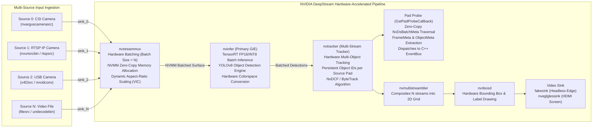
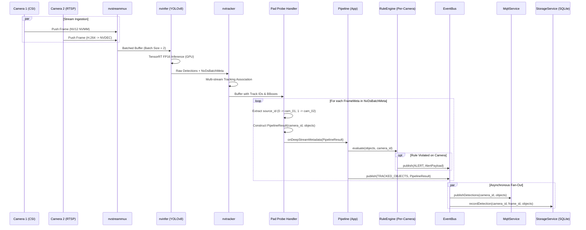

# System Design Document (SDD)
## Project: Multi-Camera Edge AI Video Analytics on Jetson with NVIDIA DeepStream SDK (Yocto Linux & C++17)

---

## 1. Architectural Philosophy: The 3-Layer DeepStream Architecture

In accordance with embedded real-time standards (AUTOSAR, POSIX profiles, IEC 62443), the multi-camera vision application is partitioned into **3 strictly defined tiers**, wrapping NVIDIA DeepStream SDK within clean, testable abstractions:

```
+-------------------------------------------------------------------------------+
| 1. APP LAYER (Business Logic & Orchestration)                                |
|    - EdgeAIManager (Lifecycle, Multi-Camera DI, Signal Handling)              |
|    - Pipeline (Dual Mode: DeepStream Orchestration / Modular Service Pipeline)|
|    - RuleEngine (Per-Camera Rules: Zone Intrusion, Line Crossing, Counting)   |
+-----------------------------------^-------------------------------------------+
                                    | calls only
+-----------------------------------v-------------------------------------------+
| 2. SERVICE LAYER (Platform-Independent Services)                              |
|    - Video Analytics: CameraService, InferenceService, TrackerService         |
|    - Processing: Preprocessor (Letterbox), Postprocessor (YOLOv8 NMS)         |
|    - Tracking Math: KalmanFilter (8D State), Hungarian (Bipartite Matcher)    |
|    - Infrastructure: EventBus (Pub/Sub), MqttService (Telemetry/Alerts)       |
|    - Persistence & Health: StorageService (SQLite), HealthService, ConfigService|
|    - Logging: LogService (spdlog thread-safe asynchronous logging)            |
+-----------------------------------^-------------------------------------------+
                                    | calls only
+-----------------------------------v-------------------------------------------+
| 3. HARDWARE ABSTRACTION LAYER - HAL (DeepStream & Driver Interfaces)          |
|    - IDeepStreamHAL (nvstreammux batching, nvinfer PGIE, nvtracker, pad probe)|
|    - ICameraHAL (MIPI CSI nvarguscamerasrc / USB V4L2)                        |
|    - IGpuHAL (CUDA runtime memory, TensorRT execution context)                |
|    - INetworkHAL (Paho MQTT), IStorageHAL (SQLite3 embedded)                  |
|    - ISensorHAL (sysfs thermal/load), IWatchdogHAL (/dev/watchdog)            |
|    - Jetson Implementations vs 100% Host PC Mock Implementations              |
+-------------------------------------------------------------------------------+
```

### Strict Layer Invariants:
1. **Rule 1 (Downwards Invocation Only)**: The App Layer orchestrates through the Service and HAL interfaces. Higher layers never expose raw GStreamer / DeepStream C structs (`GstElement*`, `NvDsBatchMeta*`) to upper business rules.
2. **Rule 2 (Upwards Delivery via Pad Probes & Event Bus)**: Frame metadata extracted inside the DeepStream Pad Probe (`GstPadProbeCallback`) is converted into clean C++ `PipelineResult` structures containing `camera_id` and `source_id`, and dispatched asynchronously via `EventBus`.
3. **Rule 3 (Dual-Mode Execution)**: In production on Jetson, `JetsonDeepStreamHAL` harnesses NVIDIA NVMM hardware DMA memory. On Host PC / CI environments, `MockDeepStreamHAL` simulates multi-channel video streams, allowing 100% automated test coverage without needing physical cameras or NVIDIA hardware.

---

## 2. DeepStream Multi-Camera Pipeline Architecture



### DeepStream Pipeline Key Elements:
* **`nvurisrcbin` / `nvarguscamerasrc`**: Decodes camera video streams using hardware NVDEC (NVIDIA Video Decoder) or Tegra ISP directly into unified NVMM memory (`video/x-raw(memory:NVMM)`).
* **`nvstreammux`**: Multiplexes $N$ asynchronous camera streams into a single batched NVMM tensor buffer with fixed width/height and configured timeout (`batched-push-timeout = 40000 µs`).
* **`nvinfer`**: Executes batched TensorRT engine inference on NVIDIA Maxwell/Ampere/Orin GPU cores with zero host-to-device memory copies.
* **`nvtracker`**: Maintains independent Kalman filter trajectories and Hungarian matching for each `source_id`, assigning globally consistent `object_id`s across continuous frames.
* **Pad Probe**: Intercepts the GStreamer buffer downstream of `nvtracker`, extracting structured detection and tracking data without duplicating video memory.

---

## 3. End-to-End Multi-Camera Data Flow



---

## 4. Multi-Camera Concurrency & Threading Model

The multi-camera DeepStream runtime operates within a single high-performance process leveraging **GStreamer native pipeline threads and application worker threads**:

| Thread ID | Thread Name | Owner | Role & Priority | Execution Frequency |
|---|---|---|---|---|
| **T1** | **Main App Thread** | `EdgeAIManager` | Initialization, signal handling, periodic liveness checks | Periodic sleep (50ms) |
| **T2..k** | **Source Streaming Threads** | GStreamer `nvurisrcbin` | Ingests RTSP/CSI RTP packets and runs hardware NVDEC decode | 30 FPS per camera |
| **Tk+1** | **StreamMux Collector** | `nvstreammux` | Assembles frames from $N$ pads into batched buffer | 25 - 30 FPS batch rate |
| **Tk+2** | **DeepStream Pipeline Worker**| `nvinfer` & `nvtracker` | Runs TensorRT GPU inference & NvDCF tracking kernel | 25 - 30 FPS batch rate |
| **Tk+3** | **Pad Probe Dispatcher** | GStreamer Pad Probe | Traverses `NvDsBatchMeta` and calls C++ `PipelineResult` callback | Synchronous with batch completion |
| **Tk+4** | **EventBus Dispatcher** | `EventBus` | Decouples video analytics from network and disk I/O | Event-driven (CV notify) |
| **Tk+5** | **Storage Writer** | `StorageService` | Executes SQLite batch transactions with `camera_id` indexing | Every 5 sec or 50 records |
| **Tk+6** | **MQTT Network Worker** | `MqttService` | Asynchronous TCP/TLS publish with per-camera topic routing | Async socket loop |
| **Tk+7** | **Health & Watchdog** | `HealthService` | Monitors CPU/GPU temperatures and resets hardware `/dev/watchdog` | Every 30 seconds |

---

## 5. Multi-Camera Memory & Performance Budget (Jetson Platforms)

### 5.1 Performance Comparison: Legacy Manual Pipeline vs. DeepStream Multi-Camera

| Metric | Legacy Single-Camera (CPU Copy) | DeepStream 2-Camera (Jetson Nano) | DeepStream 4-Camera (Jetson Orin Nano) |
|---|---|---|---|
| **Cameras Supported** | 1 Channel | 2 Channels | 4 - 8 Channels |
| **Capture Latency** | 33 ms (CPU V4L2) | < 5 ms (Zero-copy NVMM) | < 3 ms (NVDEC Hardware) |
| **Pre-process Latency** | 5 - 6 ms (OpenCV CPU) | 0 ms (Hardware VIC scaling) | 0 ms (Hardware VIC scaling) |
| **Batch Inference (FP16)** | 42 ms (Batch = 1) | 48 ms (Batch = 2) | 18 ms (Batch = 4 Orin DLA/GPU) |
| **Post-process & Tracking**| 3 - 5 ms (CPU NMS) | 2 ms (NvTracker GPU/Hardware) | 2 ms (NvTracker) |
| **Total System FPS** | 19 - 22 FPS (1 cam) | **2 x 25 - 30 FPS (50-60 FPS total)** | **4 x 30 FPS (120 FPS total)** |
| **CPU Core Utilization** | 35% - 45% (1 cam) | **20% - 30% (2 cams)** | **15% - 25% (4 cams)** |
| **RAM Footprint** | ~720 MB | ~850 MB (NVMM shared) | ~1.2 GB |
| **Available RAM Margin** | > 3.1 GB Free | **> 3.0 GB Free** | **> 6.5 GB Free** |

### 5.2 Two-Tier Resource Governance Model

Rather than statically dividing CPU and GPU percentages per camera, the system governs resources across two logical tiers:
1. **Pipeline-Level (Global Shared Infrastructure)**:
   * **GPU Saturation**: Monitored at the batched inference level (`nvinfer` execution over $[B, 3, 640, 640]$ tensors).
   * **Unified RAM Shared Footprint**: OS rootfs, TensorRT engine deserialized weights, CUDA device context, and `nvstreammux` surface pools.
   * **Global Batch FPS & End-to-End Latency**: Measured across the entire batched pipeline graph.
2. **Per-Camera Level (Channel-Specific Telemetry & Buffering)**:
   * **Buffers & Queues**: Independent CSI capture pools, RTSP jitter buffers, bounded event queues, and tracking/rule states.
   * **Runtime Channel Telemetry**: `input_fps`, `processed_fps`, `dropped_frames`, `last_pts` (stagnation detection), `decode_latency_ms`, and `active_objects`.

---

## 6. Key Advantages & Verified Safety Standards

The architecture strictly fulfills the **10 production safety & reliability criteria** for edge multi-camera systems:

1. **Non-blocking Pad Probe**: Metadata extraction runs in $< 0.05\,\text{ms}$, dispatching asynchronously to `EventBus` without calling network or disk I/O.
2. **Strictly Bounded Queues**: `EventBus` (256 ring buffer), `MqttService` offline queue (500 messages), and `StorageService` in-memory write queue (1000 records) all enforce bounded limits to prevent OOM on 4GB Unified RAM.
3. **Synchronized Batch Sizing**: Uniform `batch-size: 2` across `app_config.yaml`, `nvstreammux`, and `deepstream_pgie_config.txt` (`nvinfer`).
4. **Preserved Request Pads on Reconnect**: `nvurisrcbin` with `rtsp-reconnect-interval` manages reconnects internally without releasing or reallocating `sink_%u` pads on `nvstreammux`.
5. **Channel-Isolated EOS Handling**: EOS from a single camera is logged on `GstBus` without stopping the global pipeline or interfering with active channels.
6. **Compound Keying in Rule State**: All tracking state in `CountingRule` and `ZoneRule` is keyed by `std::pair<std::string, int>` (`[camera_id, track_id]`), completely preventing cross-camera ID collision.
7. **Source Reconnect State Purge**: `resetCameraState(camera_id)` clears tracking coordinates and cooldown timers when a camera reconnects, preventing false tripwire triggers.
8. **Zero-Copy Hardware Memory (NVMM)**: Raw video frames flow exclusively through hardware ASICs (ISP, NVDEC, VIC) and GPU memory without copying pixels to CPU RAM.
9. **Lightweight GstBus Callback**: GstBus error/warning callbacks only format messages and return immediately ($< 5\,\mu\text{s}$), preventing main loop stalls.
10. **Deterministic 4-Phase Graceful Shutdown**: Ingress halt $\to$ Queue drain $\to$ Storage commit & MQTT disconnect $\to$ Hardware Watchdog safe release ('V').

