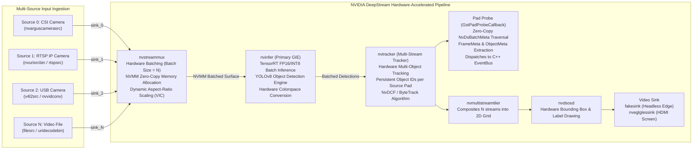
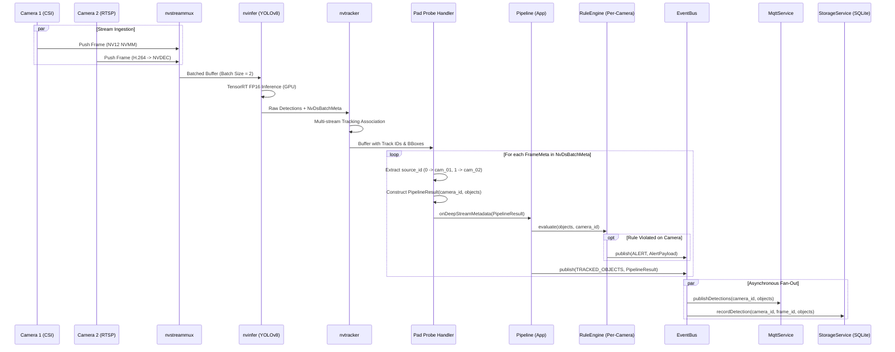

# System Design Document (SDD)
## Project: Multi-Camera Edge AI Video Analytics on Jetson with NVIDIA DeepStream SDK (Yocto Linux & C++17)

---

## 1. Architectural Philosophy: The 3-Layer DeepStream Architecture

In accordance with embedded real-time standards (AUTOSAR, POSIX profiles, IEC 62443), the multi-camera vision application is partitioned into **3 strictly defined tiers**, wrapping NVIDIA DeepStream SDK within clean, testable abstractions:

```
+-------------------------------------------------------------------------------+
| 1. APP LAYER (Business Logic & Orchestration)                                |
|    - EdgeAIManager (Lifecycle, Multi-Camera DI, Signal Handling)              |
|    - Pipeline (DeepStream Pipeline Orchestration & Frame Stepping)            |
|    - RuleEngine (Per-Camera Rules: Zone Intrusion, Line Crossing, Counting)   |
+-----------------------------------^-------------------------------------------+
                                    | calls only
+-----------------------------------v-------------------------------------------+
| 2. SERVICE LAYER (Platform-Independent Services)                              |
|    - EventBus (High-throughput asynchronous Pub/Sub dispatcher)               |
|    - MqttService (Multi-Camera Telemetry, Alert Publishing, Offline Queue)    |
|    - StorageService (SQLite Multi-Camera Table Schema, Batch Transactions)     |
|    - HealthService (Thermal, GPU/CPU load, Hardware Watchdog Keepalive)       |
|    - ConfigService (Multi-Camera YAML parser & DeepStream property loader)    |
+-----------------------------------^-------------------------------------------+
                                    | calls only
+-----------------------------------v-------------------------------------------+
| 3. HARDWARE ABSTRACTION LAYER - HAL (DeepStream & Driver Interfaces)          |
|    - IDeepStreamHAL (Multi-Source Pipeline, Pad Probe, Batch Metadata API)    |
|    - JetsonDeepStreamHAL (GStreamer 1.16+, nvstreammux, nvinfer, nvtracker)   |
|    - MockDeepStreamHAL (100% Host PC Multi-Stream Simulation without Hardware)|
|    - INetworkHAL, IStorageHAL, ISensorHAL, IWatchdogHAL                       |
+-------------------------------------------------------------------------------+
```

### Strict Layer Invariants:
1. **Rule 1 (Downwards Invocation Only)**: The App Layer orchestrates through the Service and HAL interfaces. Higher layers never expose raw GStreamer / DeepStream C structs (`GstElement*`, `NvDsBatchMeta*`) to upper business rules.
2. **Rule 2 (Upwards Delivery via Pad Probes & Event Bus)**: Frame metadata extracted inside the DeepStream Pad Probe (`GstPadProbeCallback`) is converted into clean C++ `PipelineResult` structures containing `camera_id` and `source_id`, and dispatched asynchronously via `EventBus`.
3. **Rule 3 (Dual-Mode Execution)**: In production on Jetson, `JetsonDeepStreamHAL` harnesses NVIDIA NVMM hardware DMA memory. On Host PC / CI environments, `MockDeepStreamHAL` simulates multi-channel video streams, allowing 100% automated test coverage without needing physical cameras or NVIDIA hardware.

---

## 2. DeepStream Multi-Camera Pipeline Architecture



### DeepStream Pipeline Key Elements:
* **`nvurisrcbin` / `nvarguscamerasrc`**: Decodes camera video streams using hardware NVDEC (NVIDIA Video Decoder) or Tegra ISP directly into unified NVMM memory (`video/x-raw(memory:NVMM)`).
* **`nvstreammux`**: Multiplexes $N$ asynchronous camera streams into a single batched NVMM tensor buffer with fixed width/height and configured timeout (`batched-push-timeout = 40000 µs`).
* **`nvinfer`**: Executes batched TensorRT engine inference on NVIDIA Maxwell/Ampere/Orin GPU cores with zero host-to-device memory copies.
* **`nvtracker`**: Maintains independent Kalman filter trajectories and Hungarian matching for each `source_id`, assigning globally consistent `object_id`s across continuous frames.
* **Pad Probe**: Intercepts the GStreamer buffer downstream of `nvtracker`, extracting structured detection and tracking data without duplicating video memory.

---

## 3. End-to-End Multi-Camera Data Flow



---

## 4. Multi-Camera Concurrency & Threading Model

The multi-camera DeepStream runtime operates within a single high-performance process leveraging **GStreamer native pipeline threads and application worker threads**:

| Thread ID | Thread Name | Owner | Role & Priority | Execution Frequency |
|---|---|---|---|---|
| **T1** | **Main App Thread** | `EdgeAIManager` | Initialization, signal handling, periodic liveness checks | Periodic sleep (50ms) |
| **T2..k** | **Source Streaming Threads** | GStreamer `nvurisrcbin` | Ingests RTSP/CSI RTP packets and runs hardware NVDEC decode | 30 FPS per camera |
| **Tk+1** | **StreamMux Collector** | `nvstreammux` | Assembles frames from $N$ pads into batched buffer | 25 - 30 FPS batch rate |
| **Tk+2** | **DeepStream Pipeline Worker**| `nvinfer` & `nvtracker` | Runs TensorRT GPU inference & NvDCF tracking kernel | 25 - 30 FPS batch rate |
| **Tk+3** | **Pad Probe Dispatcher** | GStreamer Pad Probe | Traverses `NvDsBatchMeta` and calls C++ `PipelineResult` callback | Synchronous with batch completion |
| **Tk+4** | **EventBus Dispatcher** | `EventBus` | Decouples video analytics from network and disk I/O | Event-driven (CV notify) |
| **Tk+5** | **Storage Writer** | `StorageService` | Executes SQLite batch transactions with `camera_id` indexing | Every 5 sec or 50 records |
| **Tk+6** | **MQTT Network Worker** | `MqttService` | Asynchronous TCP/TLS publish with per-camera topic routing | Async socket loop |
| **Tk+7** | **Health & Watchdog** | `HealthService` | Monitors CPU/GPU temperatures and resets hardware `/dev/watchdog` | Every 30 seconds |

---

## 5. Multi-Camera Memory & Performance Budget (Jetson Platforms)

### Performance Comparison: Legacy Manual Pipeline vs. DeepStream Multi-Camera

| Metric | Legacy Single-Camera (CPU Copy) | DeepStream 2-Camera (Jetson Nano) | DeepStream 4-Camera (Jetson Orin Nano) |
|---|---|---|---|
| **Cameras Supported** | 1 Channel | 2 Channels | 4 - 8 Channels |
| **Capture Latency** | 33 ms (CPU V4L2) | < 5 ms (Zero-copy NVMM) | < 3 ms (NVDEC Hardware) |
| **Pre-process Latency** | 5 - 6 ms (OpenCV CPU) | 0 ms (Hardware VIC scaling) | 0 ms (Hardware VIC scaling) |
| **Batch Inference (FP16)** | 42 ms (Batch = 1) | 48 ms (Batch = 2) | 18 ms (Batch = 4 Orin DLA/GPU) |
| **Post-process & Tracking**| 3 - 5 ms (CPU NMS) | 2 ms (NvTracker GPU/Hardware) | 2 ms (NvTracker) |
| **Total System FPS** | 19 - 22 FPS (1 cam) | **2 x 25 - 30 FPS (50-60 FPS total)** | **4 x 30 FPS (120 FPS total)** |
| **CPU Core Utilization** | 35% - 45% (1 cam) | **20% - 30% (2 cams)** | **15% - 25% (4 cams)** |
| **RAM Footprint** | ~720 MB | ~850 MB (NVMM shared) | ~1.2 GB |
| **Available RAM Margin** | > 3.1 GB Free | **> 3.0 GB Free** | **> 6.5 GB Free** |

---

## 6. Key Advantages of the DeepStream Multi-Camera Architecture

1. **Zero-Copy NVMM Memory Pipeline**: Video frames never leave GPU memory from initial hardware decode to inference and display.
2. **Hardware Batching (`nvstreammux`)**: Multiplexing camera streams into batches maximizes GPU CUDA tensor saturation and minimizes inference overhead per frame.
3. **Per-Camera Business Rule Isolation**: Each camera channel can have dedicated polygon safety zones and tripwires defined in `rules.yaml` without interfering with adjacent camera streams.
4. **Resilient Telemetry**: Telemetry payloads tag all objects with `camera_id` and `source_id`, allowing cloud dashboards and local databases to filter incidents by camera location.
5. **Seamless Host PC Development**: `MockDeepStreamHAL` provides instant local development and CI testing on any standard workstation without Jetson hardware.
