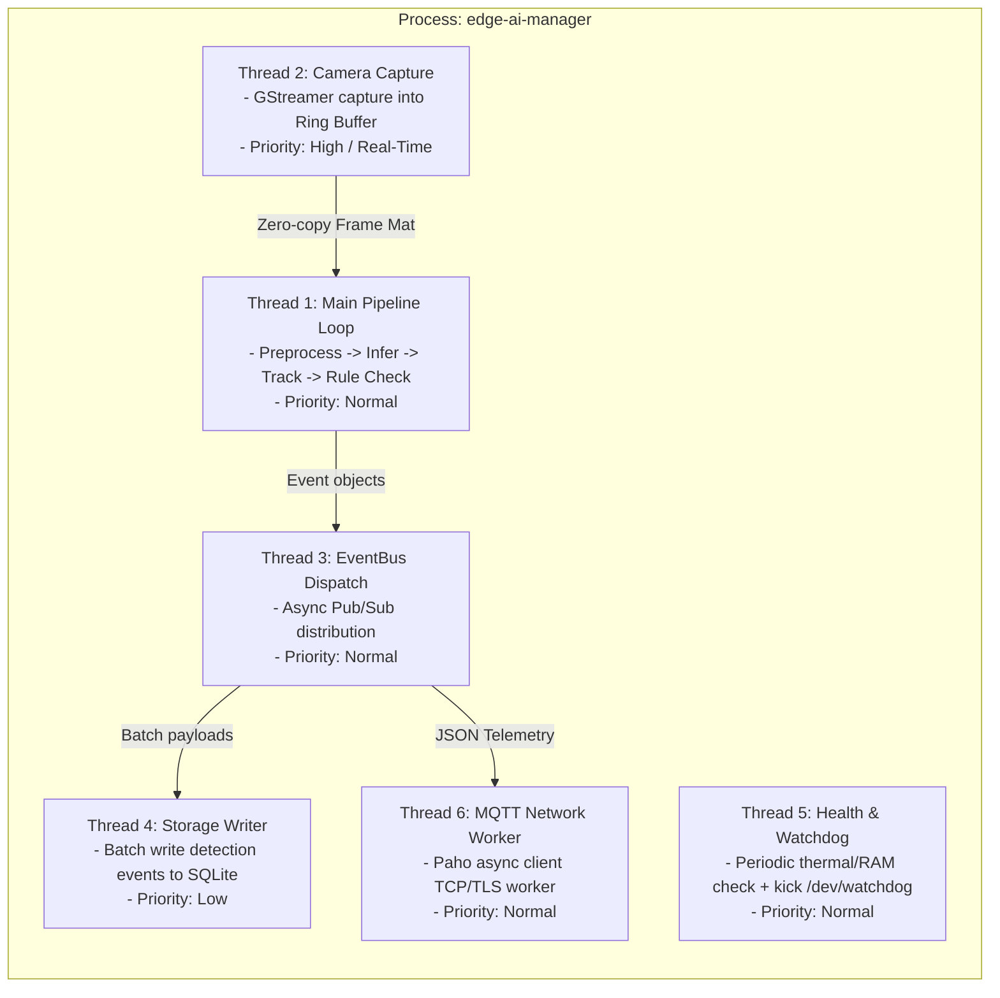
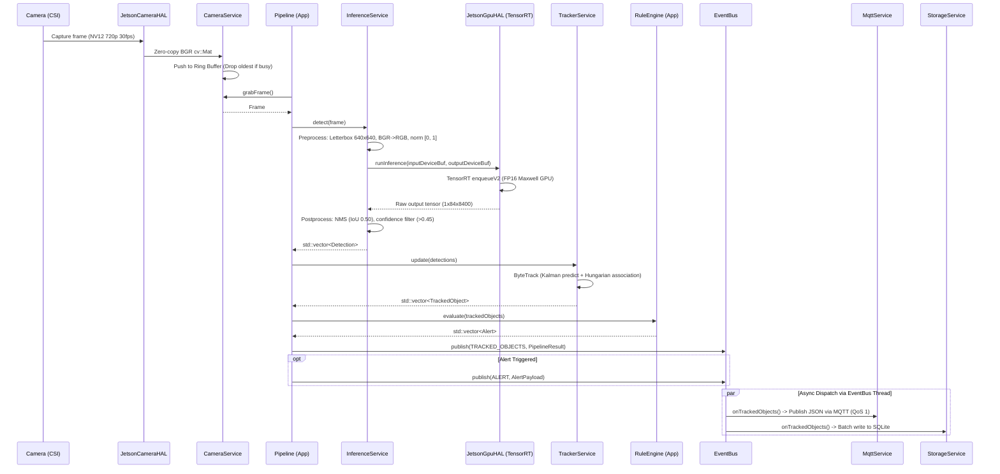

# System Design Document (SDD)
## Project: Embedded AI Object Detection on Jetson Nano 4GB (Yocto Linux)

---

## 1. Architectural Philosophy: The 3-Layer Standard

In accordance with embedded systems best practices (AUTOSAR, IEC 62443, POSIX embedded profiles), the software is partitioned into **3 strictly defined tiers**:

```
+--------------------------------------------------------------------------+
| 1. APP LAYER (Business Logic & Orchestration)                           |
|    - EdgeAIManager (Lifecycle, Dependency Injection, Signal Handling)    |
|    - Pipeline (Per-frame processing workflow)                            |
|    - RuleEngine (Domain rules: Zone Intrusion, Line Crossing, Counting)  |
+-----------------------------------^--------------------------------------+
                                    | calls only
+-----------------------------------v--------------------------------------+
| 2. SERVICE LAYER (Platform-Independent Services)                         |
|    - CameraService, InferenceService, TrackerService (ByteTrack)         |
|    - EventBus, MqttService, StorageService, HealthService, ConfigService |
+-----------------------------------^--------------------------------------+
                                    | calls only
+-----------------------------------v--------------------------------------+
| 3. HARDWARE ABSTRACTION LAYER - HAL (Hardware & Driver Interfaces)       |
|    - ICameraHAL, IGpuHAL, INetworkHAL, IStorageHAL, ISensorHAL, IWatchdog|
|    - Jetson Concrete HALs vs Mock HALs (Host Unit Testing)               |
+--------------------------------------------------------------------------+
```

### Strict Layer Invariant Rules:
1. **Rule 1 (Downwards Invocation Only)**: Layer $N$ may only call public interfaces of Layer $N-1$. The App layer NEVER bypasses the Service layer to speak to the HAL directly.
2. **Rule 2 (Upwards Notification via Event Bus / Callbacks)**: Lower layers notify upper layers asynchronously via the Event Bus or abstract callbacks.
3. **Rule 3 (Zero Hardware Knowledge in App/Service)**: No `#include <cuda_runtime.h>` or GStreamer headers are allowed inside App or Service layers. All hardware interaction is confined to `src/hal/jetson/`.

---

## 2. Process & Concurrency Architecture

The system executes as a **Single Process (`edge-ai-manager`) with 6 Dedicated POSIX Threads**:



### Rationale for Single-Process Multi-Threading on Jetson Nano 4GB:
* **Zero-Copy Memory**: Camera frames ($1280 \times 720 \text{ BGR} \approx 2.76 \text{ MB}$) and CUDA buffers are passed by pointer/reference between threads without IPC serialization.
* **Unified Memory Optimization**: 4GB LPDDR4 is shared between CPU and GPU. A single process eliminates duplicate `.so` library mapping and prevents Out-Of-Memory (OOM) faults.
* **CUDA Context Sharing**: Avoids complex and fragile multi-process CUDA IPC on JetPack 4.6.x (L4T R32.7.x).

---

## 3. End-to-End Data Flow



---

## 4. Memory & Performance Budget

| Subsystem | RAM Allocated (Target) | GPU Memory | Latency Budget |
|---|---|---|---|
| **OS / Yocto Base Rootfs** | 350 MB | 0 MB | - |
| **CUDA Driver & Context** | 200 MB | 150 MB (VRAM) | - |
| **TensorRT Engine (YOLOv8n FP16)** | 100 MB | 280 MB (VRAM) | 38 - 48 ms |
| **Camera Ring Buffer (3 frames max)**| ~10 MB | 0 MB | 5 ms |
| **OpenCV Preprocessing** | ~20 MB | 0 MB | 4 - 6 ms |
| **ByteTrack & Postprocessing (NMS)** | ~10 MB | 0 MB | 2 - 4 ms |
| **EventBus & MQTT Offline Queue** | ~15 MB | 0 MB | < 2 ms (async) |
| **SQLite DB In-memory cache** | ~25 MB | 0 MB | < 5 ms (batch) |
| **Total Target** | **~730 MB App + 350 MB OS** | **~430 MB GPU** | **~50 - 65 ms total** |
| **Free RAM Headroom** | **> 2.4 GB free** | - | **FPS: 18 - 22 FPS** |

---

## 5. Related Deep-Dive Specifications
* 🧵 **[Threading & Concurrency Model (6 Threads Detailed)](threading_model.md)**: Phân bổ 6 threads, cơ chế khóa zero-latency ring buffer, thứ tự dừng an toàn.
* ⚡ **[System Workflow Specification (CPU, GPU, RAM, Timing Matrix)](system_workflow.md)**: Đặc tả chi tiết từng mili-giây tương tác giữa CPU, GPU, RAM, DMA bus và các luồng trong 1 chu kỳ frame.


