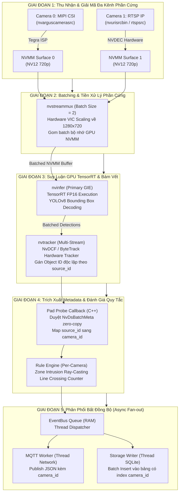

# Đặc Tả Luồng Vận Hành Hệ Thống Chi Tiết (System Workflow Specification)
## Vận Hành Multi-Camera Bằng NVIDIA DeepStream SDK Trên Jetson (JetPack & Yocto Linux)

Tài liệu này phân tích chi tiết **luồng vận hành từng mili-giây (per-batch workflow)** của hệ thống đa camera (Multi-Camera), chỉ rõ tại mỗi bước: **Thread nào thực thi**, **CPU làm gì**, **GPU/Hardware Accelerators làm gì**, **RAM biến động như thế nào** và **thời gian tiêu tốn bao lâu**.

---

## 1. Sơ Đồ Tổng Thể Luồng Dữ Liệu & Phân Bổ Phần Cứng DeepStream

---

## 2. Chi Tiết Từng Bước Vận Hành (Step-by-Step Lifecycle)

Dưới đây là hành trình của 1 mẻ khung hình (batch of frames) từ khi ánh sáng đi vào các cảm biến camera đến khi bản tin telemetry đa kênh được phát hành lên MQTT Cloud:

### 🟢 Bước 1: Thu Nhận & Giải Mã Đồng Thời Đa Camera (Multi-Source Acquisition)
* **Luồng thực thi**: **Source Streaming Threads (T2..N)**
* **Hành vi phần cứng**:
  * **CSI Camera**: Chip ISP (Image Signal Processor) trên SoC Tegra tự động demosaic, cân bằng trắng (AWB) và chuyển đổi sang định dạng NV12.
  * **RTSP IP Camera**: Chip NVDEC (Hardware Video Decoder) giải mã luồng bitstream H.264/H.265 từ mạng Ethernet trực tiếp vào bộ nhớ GPU NVMM.
* **Hành vi RAM (Unified Memory)**:
  * Không copy qua RAM CPU. Dữ liệu được cấp phát trực tiếp trong buffer DMA phần cứng `video/x-raw(memory:NVMM)`.
* **Thời gian tiêu tốn**: $\mathbf{33.3 \text{ ms}}$ (chạy song song liên tục ở tốc độ 30 FPS).

---

### 🟢 Bước 2: Gom Mẻ & Tiền Xử Lý Bằng Phần Cứng (`nvstreammux`)
* **Luồng thực thi**: **StreamMux Collector Thread**
* **Hành vi phần cứng**:
  * Bộ điều phối `nvstreammux` đồng bộ hóa các luồng camera với timeout cấu hình `batched-push-timeout: 40000 µs`.
  * Bộ tăng tốc phần cứng **VIC (Video Image Compositor)** thực hiện scale kích thước ảnh và đổi hệ màu nếu cần, ghép $N$ khung hình vào 1 mảng surface liên tục trong bộ nhớ GPU.
* **Thời gian tiêu tốn**: $\mathbf{1.0 - 2.5 \text{ ms}}$ (hoàn toàn bằng phần cứng VIC, tải CPU $< 5\%$).

---

### 🟢 Bước 3: Suy Luận Mạng Nơ-ron Theo Lô (Batched TensorRT Inference - `nvinfer`)
* **Luồng thực thi**: **DeepStream PGIE Worker Thread**
* **Hành vi GPU**:
  * TensorRT nạp batch gồm 2 frame vào GPU Cores và chạy mạng nơ-ron YOLOv8 FP16.
  * Nhờ cơ chế batching, chi phí khởi chạy kernel (kernel launch overhead) giảm mạnh so với việc chạy 2 lần đơn lẻ.
* **Hành vi RAM**:
  * Input tensor nằm cố định trong NVMM Buffer.
  * Output tensor được sinh ra tại bộ nhớ GPU device buffer, DeepStream tự động giải mã tọa độ hộp BBox và độ tin cậy, gắn vào cấu trúc `NvDsObjectMeta`.
* **Thời gian tiêu tốn**: $\mathbf{45.0 - 52.0 \text{ ms}}$ cho cả batch 2 camera (trung bình $\approx \mathbf{24 \text{ ms}}$ / camera).

---

### 🟢 Bước 4: Bám Vết Đa Camera Đồng Thời (`nvtracker`)
* **Luồng thực thi**: **DeepStream Tracker Worker Thread**
* **Hành vi phần cứng & Thuật toán**:
  * Module `nvtracker` phân tách metadata theo `source_id` (kênh camera).
  * Chạy thuật toán lọc Kalman và trích xuất đặc trưng hình thái (NvDCF hoặc ByteTrack) độc lập cho từng camera, gán `object_id` duy nhất và tính vận tốc di chuyển.
* **Thời gian tiêu tốn**: $\mathbf{1.5 - 2.5 \text{ ms}}$ cho cả mẻ.

---

### 🟢 Bước 5: Trích Xuất Metadata Không Sao Chép Điểm Ảnh (Pad Probe Callback)
* **Luồng thực thi**: **Pad Probe Dispatcher Thread**
* **Hành vi C++**:
  * Callback `JetsonDeepStreamHAL::padProbeCallback()` nhận con trỏ buffer GStreamer.
  * Duyệt `NvDsBatchMeta` $\to$ `NvDsFrameMeta` $\to$ `NvDsObjectMeta`.
  * Ánh xạ `frame_meta->source_id` sang mã camera tương ứng (ví dụ: `0` $\to$ `"cam_01"`, `1` $\to$ `"cam_02"`).
  * Đóng gói thông tin tọa độ hộp vào `PipelineResult` ($< 1\text{ KB}$ heap memory).
* **Thời gian tiêu tốn**: $\mathbf{0.2 - 0.4 \text{ ms}}$ (tuyệt đối không copy dữ liệu ảnh).

---

### 🟢 Bước 6: Đánh Giá Quy Tắc Nghiệp Vụ Theo Kênh Camera (Rule Engine)
* **Luồng thực thi**: **Pipeline Callback $\to$ RuleEngine**
* **Hành vi CPU**:
  * Quy tắc chỉ đánh giá các vật thể có `obj.camera_id` khớp với `rule.camera_id` (hoặc wildcard `*`).
  * Thực thi thuật toán Ray-Casting kiểm tra xâm nhập vùng polygon và tính tích có hướng phát hiện xe vượt vạch.
  * Nếu vi phạm, tạo đối tượng `Alert` chứa đầy đủ `camera_id`, `rule_id`, `track_id` và nhãn vi phạm.
* **Thời gian tiêu tốn**: $\mathbf{0.1 - 0.3 \text{ ms}}$.

---

### 🟢 Bước 7: Phân Phối Bất Đồng Bộ (EventBus Dispatching)
* **Luồng thực thi**: **Pipeline $\to$ EventBus Thread**
* **Hành vi CPU**:
  * Đẩy `PipelineResult` vào hàng đợi `EventBus`. Luồng xử lý video tiếp tục nhận batch mới ngay lập tức.
  * Luồng `EventBus` thức dậy và gọi các subscriber (`MqttService` và `StorageService`).
* **Thời gian tiêu tốn**: $\mathbf{< 0.05 \text{ ms}}$ (không làm nghẽn luồng video).

---

### 🟢 Bước 8: Xuất Bản Telemetry Mạng & Ghi Đĩa Theo Mẻ (MQTT & SQLite)
* **Luồng thực thi**: **MQTT Network Worker** & **Storage Writer Thread**
* **Hành vi I/O**:
  * **MQTT**: Tuần tự hóa JSON gắn thẻ `camera_id`, gửi gói tin QoS 1 lên topic `edge/{device_id}/detections`.
  * **Storage**: Gom các bản ghi nhận diện và cảnh báo, mở Transaction ghi mẻ vào SQLite với bảng đã đánh chỉ mục `idx_det_camera`.
* **Thời gian tiêu tốn**: Chạy hoàn toàn ngầm ở background, không ảnh hưởng đến FPS.

---

## 3. Ma Trận Phân Bổ Tài Nguyên Đa Camera (Resource & Latency Matrix)

Bảng tổng hợp chi tiết tài nguyên của 1 chu kỳ xử lý batch 2 camera ($1280 \times 720$):

| Bước | Tác vụ | Thành phần phụ trách | CPU Load (%) | Tăng tốc phần cứng | RAM / VRAM | Độ trễ (Latency) |
|:---:|---|:---:|:---:|:---:|:---:|:---:|
| **1** | Multi-Source Ingest & Decode | `nvurisrcbin` / `nvargus` | 4% – 8% | ISP + NVDEC | NVMM Zero-copy DMA | 33.3 ms (30 FPS rate) |
| **2** | Hardware Muxing & Scaling | `nvstreammux` | 3% – 5% | VIC Scaler | Batched Surface NVMM | 1.0 – 2.5 ms |
| **3** | **TensorRT Batched Inference** | **`nvinfer` (YOLOv8)** | **< 5%** | **100% GPU Maxwell/Orin**| **128 MB VRAM Workspace** | **45.0 – 52.0 ms (Batch 2)** |
| **4** | Multi-Stream Tracking | `nvtracker` (NvDCF) | 5% – 8% | GPU / CPU Tracking | < 50 KB Track state | 1.5 – 2.5 ms |
| **5** | Pad Probe Metadata Extract | Pad Probe Handler | < 2% | - | < 2 KB (Metadata only) | 0.2 – 0.4 ms |
| **6** | Per-Camera Rule Check | `RuleEngine` | < 1% | - | < 2 KB Alert object | 0.1 – 0.3 ms |
| **7** | EventBus Dispatch | `EventBus` | < 1% | - | ~5 KB Event payload | < 0.05 ms |
| **8** | MQTT Publish & SQLite Batch | MQTT & Storage Workers | 2% – 5% | - | SQLite Cache ~25 MB | Không block (< 2 ms ngầm) |
| **9** | Watchdog Keepalive | `HealthService` | < 0.5% | - | < 1 MB | 0.5 ms (mỗi 30s) |

---

## 4. Bảng Phân Bổ Bộ Nhớ Unified Memory (Multi-Camera Jetson Budget)

Jetson Nano sở hữu **4GB LPDDR4 Unified Memory** dùng chung cho CPU và GPU. Dưới đây là bảng phân bổ thực tế cho hệ thống chạy **2 camera DeepStream**:

| Thành Phần Bộ Nhớ | Dung Lượng Chiếm Dụng | Ghi Chú Kỹ Thuật |
|---|---|---|
| **Yocto Minimal Linux OS** | ~320 MB | Bản phân phối nhúng không Desktop UI |
| **NVIDIA Driver & CUDA/DeepStream Context** | ~220 MB | Driver, GStreamer plugins, EGL runtime |
| **TensorRT Engine Workspace (Batch Size 2)**| ~128 MB | Workspace cấp phát cho batch execution |
| **YOLOv8 Weights & Parameters** | ~14 MB | Trọng số mô hình FP16 |
| **NVMM Batched Frame Buffers (2 x 720p)** | ~35 MB | Bộ đệm DMA phần cứng cho 2 luồng video |
| **NvTracker Internal State Buffers** | ~20 MB | Lưu trữ trạng thái bám vết đa camera |
| **SQLite Page Cache & WAL Mode** | ~25 MB | Giới hạn cache ghi mẻ trong RAM |
| **Paho MQTT Offline Queue (500 msgs)** | ~5 MB | Hàng đợi lưu tạm khi rớt mạng |
| **Stack & Heap Ứng Dụng C++17** | ~40 MB | Quản lý tiến trình, EventBus, Rule Engine |
| **TỔNG BỘ NHỚ SỬ DỤNG** | **~807 MB** | **Chiếm ~20% tổng dung lượng 4GB** |
| **DUNG LƯỢNG RAM DỰ PHÒNG CÒN TRỐNG** | **> 3.1 GB TRỐNG** | **An toàn tuyệt đối, loại trừ hoàn toàn nguy cơ OOM** |
