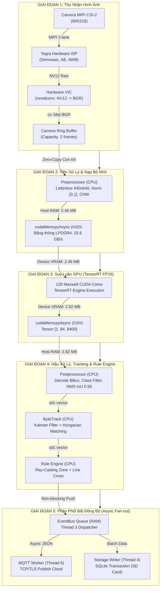

# Đặc Tả Luồng Vận Hành Hệ Thống Chi Tiết (System Workflow Specification)
## Tương Tác CPU, GPU, RAM và Threads Trên Jetson Nano 4GB (JetPack 4.6.x)

Tài liệu này phân tích chi tiết **luồng vận hành từng mili-giây (per-frame workflow)** của hệ thống, chỉ rõ tại mỗi bước: **Thread nào thực thi**, **CPU làm gì**, **GPU làm gì**, **RAM biến động như thế nào** và **thời gian tiêu tốn bao lâu**.

---

## 1. Sơ Đồ Tổng Thể Luồng Dữ Liệu & Phân Bổ Phần Cứng



---

## 2. Chi Tiết Từng Bước Vận Hành (Step-by-Step Lifecycle)

Dưới đây là hành trình của 1 frame dữ liệu từ khi ánh sáng đi vào cảm biến camera đến khi bản tin telemetry được publish lên Cloud:

### 🟢 Bước 1: Thu nhận Frame từ Cảm Biến (Frame Acquisition)
* **Thread thực thi**: **Thread 2 (Camera Capture Thread)**
* **Hành vi CPU**: Tải CPU rất thấp ($\approx 5\%$). CPU chỉ điều phối pipeline GStreamer thông qua kernel V4L2/Argus.
* **Hành vi GPU**: Không sử dụng GPU 3D/Compute Cores. Thay vào đó, phần cứng chuyên dụng trên chip Tegra X1 hoạt động:
  * **ISP (Image Signal Processor)**: Tự động cân bằng trắng (AWB), phơi sáng (AE) và chuyển đổi Bayer sang NV12.
  * **VIC (Video Image Compositor / `nvvidconv`)**: Chuyển đổi màu từ NV12 sang BGR $1280 \times 720$.
* **Hành vi RAM (Unified Memory)**:
  * Frame được cấp phát trong vùng nhớ DMA phần cứng (`video/x-raw(memory:NVMM)`).
  * `appsink` gói vùng nhớ thành `cv::Mat` BGR kích thước $1280 \times 720 \times 3 \text{ bytes} \approx \mathbf{2.76 \text{ MB}}$.
* **Thời gian tiêu tốn**: $\mathbf{33.3 \text{ ms}}$ (chạy tuần hoàn liên tục ở tốc độ 30 FPS).

---

### 🟢 Bước 2: Bàn giao Frame Zero-Latency (Ring Buffer Handoff)
* **Thread thực thi**: **Thread 2 $\to$ Thread 1**
* **Hành vi CPU**: Thread 2 khóa `std::mutex` của Camera Ring Buffer trong thời gian cực ngắn ($< 5\ \mu\text{s}$).
* **Chính sách Drop Frame (Chống trễ)**: Nếu Thread 1 (AI) đang bận, Ring Buffer (size = 2) tự động hủy (`pop()`) frame cũ nhất, giữ lại frame mới nhất.
* **Hành vi RAM**: **Zero-Copy**. Không sao chép 2.76 MB điểm ảnh, chỉ chuyển giao con trỏ tham chiếu (`std::move` và reference counting của `cv::Mat`).
* **Thời gian tiêu tốn**: $\mathbf{< 0.01 \text{ ms}}$.

---

### 🟢 Bước 3: Tiền Xử Lý Hình Ảnh (Preprocessing - Letterbox)
* **Thread thực thi**: **Thread 1 (Main Pipeline Thread)**
* **Hành vi CPU**: 1 nhân ARM Cortex-A57 tính toán ma trận hình ảnh:
  1. Tính tỷ lệ scale: $\min(640/1280, 640/720) = 0.5$. Resize ảnh về $640 \times 360$.
  2. Bù viền trên/dưới $140\text{ px}$ với màu xám `(114, 114, 114)` tạo canvas vuông $640 \times 640$.
  3. Đổi hệ màu BGR $\to$ RGB.
  4. Chuẩn hóa pixel về đoạn $[0.0, 1.0]$ và đổi định dạng từ HWC sang CHW.
* **Hành vi GPU**: GPU ở trạng thái chờ (Idle).
* **Hành vi RAM**:
  * Đọc `cv::Mat` gốc ($2.76\text{ MB}$).
  * Ghi ra mảng host `std::vector<float>` CHW: $1 \times 3 \times 640 \times 640 \times 4\text{ bytes} \approx \mathbf{4.91 \text{ MB}}$ (hoặc $\mathbf{2.46 \text{ MB}}$ nếu cast FP16).
* **Thời gian tiêu tốn**: $\mathbf{4.0 - 6.0 \text{ ms}}$.

---

### 🟢 Bước 4: Chuyển Vùng Nhớ Host $\to$ Device (Memory Copy H2D)
* **Thread thực thi**: **Thread 1**
* **Hành vi CPU**: Phát lệnh gọi hàm `cudaMemcpyAsync(..., cudaMemcpyHostToDevice, stream_)`.
* **Hành vi GPU**: Bộ điều khiển DMA (Direct Memory Access) của Tegra X1 nạp dữ liệu vào VRAM dành riêng cho GPU.
* **Hành vi RAM**: Băng thông bus LPDDR4 là $25.6\text{ GB/s}$. Truyền $2.46\text{ MB}$ dữ liệu FP16.
* **Thời gian tiêu tốn**: $\mathbf{\approx 0.10 \text{ ms}}$ (cực nhanh trên kiến trúc bộ nhớ chia sẻ).

---

### 🟢 Bước 5: Thực Thi Suy Luận Mạng Nơ-ron (TensorRT GPU Inference)
* **Thread thực thi**: **Thread 1 $\to$ Maxwell GPU Driver**
* **Hành vi CPU**: Thread 1 gọi `context_->enqueueV2()` và đồng bộ hóa qua `cudaStreamSynchronize(stream_)`. CPU tiêu thụ $< 5\%$ trong bước này (chủ yếu chờ GPU).
* **Hành vi GPU**: **Hoạt động 100% công suất**.
  * Cả 128 Maxwell CUDA Cores kích hoạt, chạy các phép toán nhân ma trận GEMM và tích chập (Convolution) ở chế độ bán chính xác **FP16**.
  * Bộ nhớ đệm TensorRT Workspace cấp phát cố định $\approx \mathbf{128 \text{ MB}}$ trong GPU Memory.
* **Hành vi RAM**: Tensor input được tính toán xuyên suốt các layer, sinh ra tensor đầu ra tại GPU device buffer: kích thước $1 \times 84 \times 8400 \times 4\text{ bytes} \approx \mathbf{2.82 \text{ MB}}$.
* **Thời gian tiêu tốn**: $\mathbf{38.0 - 45.0 \text{ ms}}$ (đây là bước chiếm nhiều thời gian nhất của chu kỳ frame).

---

### 🟢 Bước 6: Kéo Kết Quả Device $\to$ Host (Memory Copy D2H)
* **Thread thực thi**: **Thread 1**
* **Hành vi CPU**: Gọi `cudaMemcpyAsync(..., cudaMemcpyDeviceToHost, stream_)`.
* **Hành vi GPU & RAM**: Sao chép $2.82\text{ MB}$ raw tensor kết quả từ GPU VRAM về RAM CPU (`host_output_tensor_`).
* **Thời gian tiêu tốn**: $\mathbf{\approx 0.12 \text{ ms}}$.

---

### 🟢 Bước 7: Hậu Xử Lý & Lọc Trùng Lặp (Postprocessing & NMS)
* **Thread thực thi**: **Thread 1**
* **Hành vi CPU**: CPU ARM xử lý $8400$ điểm neo (anchor points):
  1. Duyệt qua 8400 anchor, lấy điểm confidence cao nhất trong 80 class.
  2. Lọc bỏ các anchor có $\text{score} < 0.45$ (loại bỏ $\approx 99\%$ số anchor rác).
  3. Nghịch đảo tọa độ bù viền (Unpad & Rescale) đưa box về độ phân giải gốc $1280 \times 720$.
  4. Thuật toán **Non-Maximum Suppression (NMS)** chạy trên CPU với ngưỡng IoU $0.50$.
* **Hành vi GPU**: GPU đã hoàn thành và nghỉ (Idle), sẵn sàng nhận frame tiếp theo.
* **Hành vi RAM**: Đầu ra là `std::vector<Detection>` chứa khoảng $1 - 10$ vật thể, dung lượng heap tiêu tốn $\mathbf{< 1 \text{ KB}}$.
* **Thời gian tiêu tốn**: $\mathbf{2.0 - 3.5 \text{ ms}}$.

---

### 🟢 Bước 8: Bám Vết Đa Vật Thể (ByteTrack Multi-Object Tracking)
* **Thread thực thi**: **Thread 1**
* **Hành vi CPU**:
  1. **Dự đoán Kalman**: Nhân ma trận chuyển trạng thái $8 \times 8$ để ngoại suy vị trí hộp $[x, y, a, h, v_x, v_y, v_a, v_h]$.
  2. **Ghép cặp Hungarian**: Tính ma trận chi phí IoU giữa các Track cũ và Detection mới.
  3. **Cập nhật trạng thái**: Gán `track_id` duy nhất, tính vận tốc di chuyển ($v_x, v_y$).
* **Hành vi GPU**: Không sử dụng.
* **Hành vi RAM**: Lưu danh sách các track đang hoạt động trong RAM, kích thước $\mathbf{< 10 \text{ KB}}$.
* **Thời gian tiêu tốn**: $\mathbf{1.0 - 2.0 \text{ ms}}$.

---

### 🟢 Bước 9: Đánh Giá Quy Tắc Nghiệp Vụ (Rule Engine Evaluation)
* **Thread thực thi**: **Thread 1**
* **Hành vi CPU**:
  * **Zone Intrusion**: Thuật toán Ray-Casting kiểm tra tọa độ tâm vật thể có nằm trong đa giác Polygon hay không.
  * **Line Crossing**: Tính tích có hướng (Cross-product) giữa vector đường thẳng và tọa độ vật thể để phát hiện xe vượt vạch.
* **Hành vi GPU**: Không sử dụng.
* **Hành vi RAM**: Nếu vi phạm quy tắc, tạo đối tượng `Alert` trên stack. Dung lượng $\mathbf{< 2 \text{ KB}}$.
* **Thời gian tiêu tốn**: $\mathbf{0.1 - 0.2 \text{ ms}}$.

---

### 🟢 Bước 10: Phân Phối Bất Đồng Bộ (EventBus Dispatching)
* **Thread thực thi**: **Thread 1 $\to$ Thread 3 (EventBus Dispatcher)**
* **Hành vi CPU**:
  * Thread 1 đóng gói `PipelineResult`, đẩy vào hàng đợi `event_queue_` của EventBus và gọi `cv_.notify_one()`. **Thread 1 hoàn tất chu kỳ frame và quay lại Bước 1 ngay lập tức**.
  * Thread 3 thức dậy từ trạng thái `wait()`, lấy event ra và gọi các hàm callback đăng ký của `MqttService` và `StorageService`.
* **Hành vi RAM**: Payload event nằm trong bộ nhớ RAM tạm thời ($\approx 5\text{ KB}$).
* **Thời gian tiêu tốn của Thread 1**: $\mathbf{< 0.05 \text{ ms}}$ (Thread 1 không bị nghẽn).

---

### 🟢 Bước 11: Xuất Bản Telemetry Mạng & Lưu Trữ Đĩa (MQTT & SQLite Batch)
* **Thread thực thi**: **Thread 6 (MQTT Worker)** và **Thread 4 (Storage Writer)**
* **Hành vi CPU**:
  * **Thread 6 (MQTT)**: Tuần tự hóa JSON, gọi thư viện Paho MQTT gửi gói tin Publish QoS 1 qua socket TCP. Tự động chuyển vào hàng đợi ngoại tuyến (Offline Queue) nếu mất mạng.
  * **Thread 4 (Storage)**: Gom mẻ các bản ghi detection, mở Transaction và thực thi lệnh ghi Batch xuống SQLite sau mỗi 5 giây.
* **Hành vi GPU**: Không sử dụng.
* **Hành vi RAM**: Cache SQLite WAL mode tiêu tốn khoảng $10 - 20\text{ MB}$ RAM.
* **Thời gian tiêu tốn**: Chạy hoàn toàn ngầm ở background, không ảnh hưởng đến FPS của hệ thống AI.

---

### 🟢 Bước 12: Giám Sát Phần Cứng & Đá Watchdog (Định Kỳ)
* **Thread thực thi**: **Thread 5 (Health & Watchdog Thread)**
* **Tần số**: Chạy độc lập mỗi **30 giây một lần**.
* **Hành vi CPU & Driver**:
  * Đọc sysfs `/sys/devices/virtual/thermal/thermal_zone1/temp` (CPU) và `thermal_zone2/temp` (GPU).
  * Gọi `ioctl(fd, WDIOC_KEEPALIVE, 0)` để reset bộ đếm phần cứng `/dev/watchdog`.
  * Nếu nhiệt độ CPU $> 85^\circ\text{C}$ hoặc GPU $> 90^\circ\text{C}$, phát sinh sự kiện cảnh báo khẩn cấp lên EventBus.
* **Thời gian tiêu tốn**: $\mathbf{\approx 0.5 \text{ ms}}$ mỗi chu kỳ 30 giây.

---

## 3. Ma Trận Phân Bổ Tài Nguyên (Resource Allocation Matrix)

Bảng tổng hợp chi tiết tài nguyên của từng bước trong 1 chu kỳ xử lý frame ($1280 \times 720 \to 640 \times 640$):

| Bước | Tên Công Việc | Thread Phụ Trách | CPU Load (%) | GPU Load (%) | RAM Biến Động | Độ Trễ (Latency) |
|:---:|---|:---:|:---:|:---:|:---:|:---:|
| **1** | Camera Capture (ISP + VIC) | Thread 2 | 5% – 8% | 0% (Dùng ISP) | +2.76 MB (Frame BGR) | 33.3 ms (30 FPS rate) |
| **2** | Buffer Handoff (Zero-copy) | Thread 2 $\to$ 1 | < 1% | 0% | 0 MB (Chỉ đổi con trỏ) | < 0.01 ms |
| **3** | Preprocessing (Letterbox) | Thread 1 | 25% – 35% | 0% | +2.46 MB (FP16 CHW) | 4.0 – 6.0 ms |
| **4** | Memcpy Host $\to$ Device | Thread 1 | < 1% | DMA Controller | Truyền 2.46 MB vào VRAM | ~0.10 ms |
| **5** | **TensorRT GPU Inference** | **Thread 1** | **< 5%** | **100% (128 Cores)**| **128 MB VRAM Workspace** | **38.0 – 45.0 ms** |
| **6** | Memcpy Device $\to$ Host | Thread 1 | < 1% | DMA Controller | Kéo 2.82 MB về RAM | ~0.12 ms |
| **7** | Postprocessing & NMS | Thread 1 | 20% – 30% | 0% | +1 KB (Heap detections) | 2.0 – 3.5 ms |
| **8** | ByteTrack Tracking | Thread 1 | 10% – 15% | 0% | +10 KB (Track state) | 1.0 – 2.0 ms |
| **9** | Rule Engine Check | Thread 1 | < 2% | 0% | < 2 KB (Alert object) | 0.1 – 0.2 ms |
| **10**| EventBus Enqueue | Thread 1 $\to$ 3 | < 1% | 0% | +5 KB (Queue payload) | < 0.05 ms |
| **11**| MQTT Publish & SQLite Batch| Thread 6 & 4 | 2% – 5% | 0% | 15 – 20 MB (Cache SQLite) | Không block (< 2 ms ngầm) |
| **12**| Health Monitor & Watchdog | Thread 5 | < 0.5% | 0% | < 1 MB | 0.5 ms (mỗi 30s) |

---

## 4. Biểu Đồ Thời Gian Thực Thi (Timing & Pipeline Timeline)

Tổng thời gian xử lý của **Thread 1 (Main Pipeline Thread)** cho 1 frame:
$$\text{Total Latency} = T_{\text{pre}} (5\text{ms}) + T_{\text{H2D}} (0.1\text{ms}) + T_{\text{infer}} (42\text{ms}) + T_{\text{D2H}} (0.1\text{ms}) + T_{\text{post}} (2.5\text{ms}) + T_{\text{track}} (1.5\text{ms}) + T_{\text{rule}} (0.2\text{ms}) \approx \mathbf{51.4 \text{ ms}}$$

$$\text{Tốc độ khung hình thực tế (FPS)} = \frac{1000 \text{ ms}}{51.4 \text{ ms}} \approx \mathbf{19.45 \text{ FPS}}$$

```
Thread 1 (Main Loop):
|--Pre (5ms)--|--H2D--|------- TensorRT GPU (42ms) -------|--D2H--|--Post (2.5ms)--|--Track (1.5ms)--|-> [Frame N hoàn thành]
                                                                                                        |--Pre (Frame N+1) ...

Thread 2 (Camera):
[Frame N: 33ms] ──────────────────────────► [Frame N+1: 33ms] ──────────────────────────► [Frame N+2: 33ms] ─────────►
```

> **Nhận xét quan trọng**: Trong lúc GPU đang tính toán ($42\text{ ms}$), CPU hoàn toàn rảnh rỗi trên luồng Inference, nhờ đó các luồng khác như Thread 2 (Camera), Thread 4 (Storage) và Thread 6 (MQTT) có đầy đủ chu kỳ CPU để hoạt động mượt mà mà không gây nghẽn cổ chai (bottleneck).

---

## 5. Chiến Lược Quản Lý Bộ Nhớ (Unified RAM Budget)

Jetson Nano sở hữu **4GB LPDDR4 Unified Memory** dùng chung cho cả CPU và GPU. Dưới đây là bảng phân bổ an toàn để tránh bị kích hoạt **Kernel OOM-Killer**:

| Thành Phần Bộ Nhớ | Dung Lượng Chiếm Dụng | Ghi Chú Kỹ Thuật |
|---|---|---|
| **Yocto Minimal Linux OS** | ~320 MB | Đã loại bỏ Desktop UI (X11/Wayland), chỉ chạy systemd & drivers |
| **NVIDIA Driver & CUDA Context** | ~180 MB | Nạp khi gọi `cudaStreamCreate` lần đầu |
| **TensorRT Engine Workspace** | ~128 MB | VRAM cấp phát cho các lớp TensorRT execution |
| **YOLOv8 Weights & Parameters** | ~14 MB | Trọng số mạng nơ-ron FP16 |
| **Input/Output CUDA Buffers** | ~6 MB | Cố định 2.46 MB in + 2.82 MB out (tái sử dụng, không cấp phát lại) |
| **OpenCV & Frame Ring Buffers** | ~15 MB | Tối đa 2 frames 720p đồng thời |
| **SQLite Page Cache & WAL** | ~25 MB | Giới hạn dung lượng cache SQLite trong RAM |
| **Paho MQTT Offline Queue (500 msgs)**| ~5 MB | Lưu tạm thời bản tin JSON khi rớt mạng |
| **Stack & Heap của ứng dụng C++** | ~30 MB | Biến cục bộ, đối tượng Tracker và Rule Engine |
| **TỔNG BỘ NHỚ SỬ DỤNG** | **~723 MB** | **Chiếm ~18% tổng dung lượng RAM** |
| **DUNG LƯỢNG RAM DỰ PHÒNG CÒN TRỐNG** | **> 3.2 GB TRỐNG** | **An toàn tuyệt đối, không bao giờ bị tràn RAM (OOM)** |

