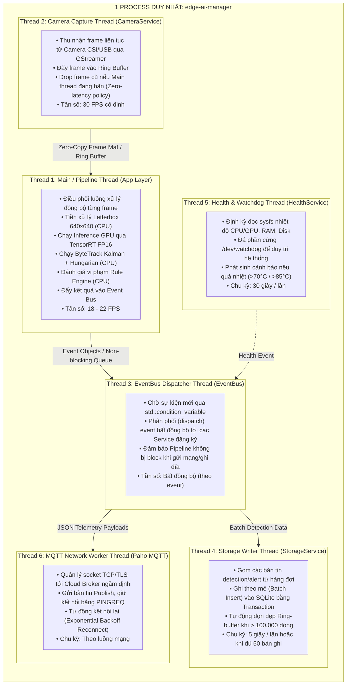

# Tài Liệu Thiết Kế Đa Luồng (Threading & Concurrency Model)
## Dự Án: Embedded AI Object Detection Trên Jetson Nano 4GB (Yocto Linux & C++17)

Tài liệu này mô tả chi tiết mô hình kiến trúc tiến trình và đa luồng (Process & Multi-threading Architecture), cơ chế đồng bộ dữ liệu (Synchronization), chính sách phân bổ CPU Core và thứ tự hủy luồng an toàn (Graceful Shutdown) của hệ thống.

---

## 1. Tổng Quan Kiến Trúc Tiến Trình & Luồng

Toàn bộ ứng dụng `edge-ai-manager` được thiết kế chạy dưới dạng **1 Single Process (Đơn tiến trình)**, bên trong phân bổ **tổng cộng 6 Threads (luồng)** chạy song song:



---

## 2. Bảng Đặc Tả Chi Tiết 6 Threads

| STT | Tên Thread | Tầng kiến trúc | Vị trí khởi tạo trong code | Chu kỳ / Tần số | Mức chiếm CPU | Trạng thái chính |
|:---:|---|---|---|---|---|---|
| **1** | **Main / Pipeline Thread** | App Layer | `src/app/main.cpp`<br>`EdgeAIManager::run()` | ~18 – 22 FPS | 20% – 30% | Running (Active) |
| **2** | **Camera Capture Thread** | Service Layer | `src/service/camera_service.cpp`<br>`CameraService::captureLoop()` | 30 FPS liên tục | 5% – 8% | Running / I/O Wait |
| **3** | **EventBus Dispatcher** | Service Layer | `src/service/event_bus.cpp`<br>`EventBus::dispatchLoop()` | Bất đồng bộ | < 1% | Blocked (`wait` trên CV) |
| **4** | **Storage Writer Thread** | Service Layer | `src/service/storage_service.cpp`<br>`StorageService::writerLoop()` | 5 giây / lần | < 1% | Sleeping (`wait_for` 5s) |
| **5** | **Health & Watchdog** | Service Layer | `src/service/health_service.cpp`<br>`HealthService::monitorLoop()` | 30 giây / lần | < 0.5% | Sleeping (30s) |
| **6** | **MQTT Network Worker** | Service / HAL | Paho MQTT C runtime ngầm | Bất đồng bộ | 1% – 2% | Socket Poll / Select |

---

## 3. Cơ Chế Đồng Bộ & Trao Đổi Dữ Liệu (Inter-Thread Communication)

### 3.1 Giữa Thread 2 (Camera) và Thread 1 (Main Pipeline): Cơ Chế Zero-Latency Ring Buffer
* **Vấn đề**: Camera CSI xuất ra 30 FPS, trong khi GPU TensorRT xử lý mất $\approx 45\text{ ms}$ (khoảng 20–22 FPS). Nếu dùng hàng đợi FIFO thông thường, độ trễ sẽ bị tích lũy (ví dụ sau 10 giây hình ảnh sẽ bị trễ 3 giây so với thực tế).
* **Giải pháp**: Sử dụng **Ring Buffer dung lượng nhỏ (2 frames)** với cờ `drop oldest`:
  ```cpp
  // Trong CameraService::captureLoop()
  std::lock_guard<std::mutex> lock(mtx_);
  if (buffer_.size() >= ring_buffer_size_) {
      buffer_.pop(); // Hủy frame cũ nhất ngay lập tức
  }
  buffer_.push(std::move(f));
  cv_.notify_one();
  ```
* **Zero-Copy**: Frame được truyền dưới dạng `cv::Mat` (cơ chế đếm tham chiếu - reference counting), chỉ sao chép header con trỏ, không copy lại vùng nhớ điểm ảnh $1280 \times 720$ (2.76 MB).

### 3.2 Giữa Thread 1 (Main Pipeline) và Thread 3 (EventBus): Cơ Chế Non-Blocking Queue
* **Vấn đề**: Main Pipeline không được phép bị nghẽn (block) bởi các tác vụ I/O mạng hoặc ghi đĩa.
* **Giải pháp**: Thread 1 chỉ tốn $\approx 0.01\text{ ms}$ để nạp `Event` vào hàng đợi `std::queue<Event>` và kích hoạt `cv_.notify_one()`, sau đó quay lại lấy frame tiếp theo ngay lập tức.

### 3.3 Giữa Thread 3 (EventBus) và Thread 4 (Storage Writer): Cơ Chế Batch Transaction
* **Vấn đề**: Thẻ nhớ MicroSD trên Jetson Nano có tốc độ ghi ngẫu nhiên (Random Write IOPS) rất kém. Ghi từng dòng riêng lẻ sẽ làm treo CPU do I/O wait.
* **Giải pháp**: Thread 4 gom hàng đợi và thực hiện ghi theo lô (Batch Insert) bên trong 1 Transaction SQLite duy nhất:
  ```sql
  BEGIN TRANSACTION;
  INSERT INTO detections ... (dòng 1);
  INSERT INTO detections ... (dòng 2);
  ...
  COMMIT;
  ```

---

## 4. Phân Bổ Tải Trên 4 Nhân CPU ARM Cortex-A57 (Jetson Nano)

Chip **NVIDIA Tegra X1** trang bị 4 nhân CPU ARM Cortex-A57 @ 1.43 GHz:

```
[Core 0] ────────► Thread 1 (Main Pipeline Loop: Preprocess + Tracking)
[Core 1] ────────► Thread 2 (Camera Capture GStreamer ISP/V4L2)
[Core 2] ────────► Thread 3 (EventBus) + Thread 6 (MQTT Network Worker)
[Core 3] ────────► Thread 4 (Storage) + Thread 5 (Health Watchdog) + System Daemons
```

### Tại sao 6 luồng không làm chậm hệ thống?
* Trong 6 luồng, **chỉ có 2 luồng hoạt động liên tục** (Thread 1 và Thread 2).
* 4 luồng còn lại hầu hết thời gian ở trạng thái **Sleep hoặc Blocked trên Condition Variable**, thức dậy trong vài mili-giây rồi ngủ tiếp.
* Do đó, hệ thống không bị hiện tượng "tranh chấp tài nguyên chuyển đổi ngữ cảnh" (Context-Switching Thrashing), tổng mức sử dụng CPU toàn hệ thống duy trì ở mức tối ưu: **35% – 45%**.

---

## 5. Thứ Tự Dừng Luồng An Toàn (Graceful Shutdown Order)

Khi người dùng nhấn `Ctrl+C` hoặc systemd gửi tín hiệu `SIGTERM`, hàm `EdgeAIManager::shutdown()` hủy các luồng theo **thứ tự ngược lại với lúc khởi tạo** để tránh Deadlock và Dangling Pointer:

```
[Bước 1] pipeline_->stop()         ── Dừng vòng lặp bắt frame chính.
[Bước 2] camera_svc_->close()      ── Đặt running_=false, notify_all, join() capture_thread_.
[Bước 3] health_svc_->stop()       ── Đặt running_=false, join() monitor_thread_, đóng watchdog.
[Bước 4] storage_svc_->shutdown()  ── Flush toàn bộ bản ghi còn sót lại xuống đĩa, join() writer_thread_.
[Bước 5] mqtt_svc_->disconnect()   ── Ngắt kết nối socket broker sạch sẽ.
[Bước 6] event_bus_->stop()        ── Đặt running_=false, notify_all, join() dispatch_thread_.
```
Toàn bộ tài nguyên bộ nhớ GPU (`cudaFree`) và kết nối phần cứng được giải phóng hoàn toàn trước khi tiến trình kết thúc với mã trả về `0`.

