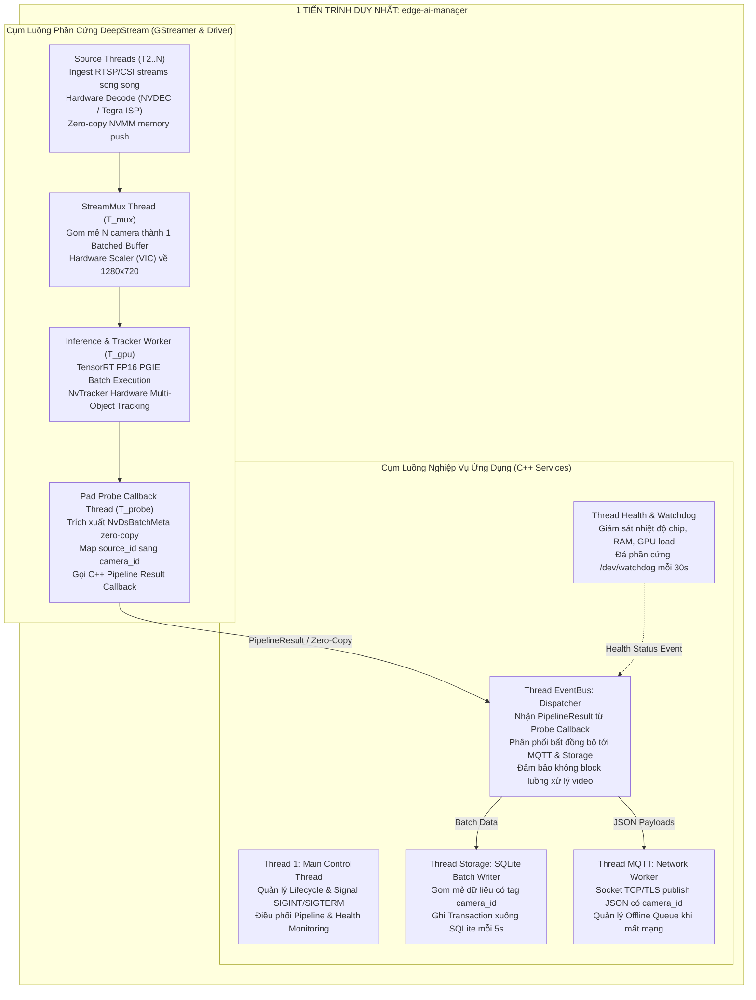

# Tài Liệu Thiết Kế Đa Luồng (Threading & Concurrency Model)
## Dự Án: Hệ Thống Multi-Camera AI Trên NVIDIA Jetson Bằng DeepStream SDK & C++17

Tài liệu này mô tả chi tiết mô hình kiến trúc tiến trình và đa luồng (Process & Multi-threading Architecture), cơ chế đồng bộ dữ liệu (Synchronization), chính sách phân bổ CPU Core và thứ tự giải phóng luồng an toàn (Graceful Shutdown) của hệ thống đa camera.

---

## 1. Tổng Quan Kiến Trúc Tiến Trình & Luồng

Ứng dụng `edge-ai-manager` thực thi dưới dạng **1 Single Process (Đơn tiến trình)** nhằm tối ưu hóa bộ nhớ Unified Memory trên Jetson, kết hợp giữa **các luồng phần cứng của GStreamer/DeepStream** và **các luồng Service hướng sự kiện của C++**:



---

## 2. Bảng Đặc Tả Chi Tiết Các Luồng Trong Hệ Thống

| Nhóm Luồng | Tên Luồng | Tầng kiến trúc | Quản lý bởi | Chu kỳ / Tần số | Mức chiếm CPU | Vai trò kỹ thuật chính |
|---|---|---|---|---|---|---|
| **App** | **Main Thread** | App Layer | `main.cpp`<br>`EdgeAIManager::run()` | Định kỳ 50ms | < 1% | Giám sát trạng thái, bắt tín hiệu dừng `Ctrl+C` |
| **DeepStream** | **Source Workers (1..N)** | GStreamer HAL | `nvurisrcbin` / `nvarguscamerasrc` | 30 FPS / camera | 3% – 5% / cam | Nhận gói tin RTP RTSP hoặc tín hiệu MIPI CSI, gọi phần cứng NVDEC decode |
| **DeepStream** | **StreamMux Collector** | GStreamer HAL | `nvstreammux` | 25 – 30 batches/s | 4% – 6% | Gom $N$ frame thành 1 batched surface, kích hoạt timeout 40ms |
| **DeepStream** | **PGIE & Tracker Worker** | GStreamer / CUDA | `nvinfer` & `nvtracker` | 25 – 30 batches/s | < 5% CPU<br>**(100% GPU)** | Đưa batch vào GPU TensorRT và bám vết đa camera NvDCF |
| **DeepStream** | **Pad Probe Thread** | GStreamer HAL | `JetsonDeepStreamHAL::padProbeCallback` | Bất đồng bộ theo batch | 2% – 4% | Duyệt danh sách metadata `NvDsBatchMeta`, đóng gói `PipelineResult` |
| **Service** | **EventBus Dispatcher** | Service Layer | `EventBus::dispatchLoop()` | Bất đồng bộ | < 1% | Đẩy kết quả nhận diện sang MQTT và SQLite không làm block video |
| **Service** | **Storage Writer** | Service Layer | `StorageService::writerLoop()` | 5 giây / lần | < 1% | Ghi theo mẻ (Batch Transaction) vào bảng SQLite có index `camera_id` |
| **Service** | **MQTT Worker** | Service / HAL | Paho MQTT C runtime | Bất đồng bộ | 1% – 2% | Quản lý socket TCP/TLS, publish telemetry kèm `camera_id` |
| **Service** | **Health & Watchdog** | Service Layer | `HealthService::monitorLoop()` | 30 giây / lần | < 0.5% | Đọc sysfs nhiệt độ, đá `/dev/watchdog` duy trì hệ thống |

---

## 3. Cơ Chế Đồng Bộ & Trao Đổi Dữ Liệu Đa Luồng

### 3.1 Truyền Dữ Liệu Zero-Copy Trong DeepStream (NVMM DMA Memory)
* **Vấn đề**: Với 2 đến 4 camera độ phân giải 720p/1080p, việc sao chép frame qua lại giữa CPU và GPU sẽ làm nghẽn bus LPDDR4 và chiếm 100% CPU.
* **Giải pháp DeepStream**: Toàn bộ luồng từ Hardware Decode (NVDEC) $\to$ `nvstreammux` $\to$ `nvinfer` $\to$ `nvtracker` $\to$ `nvdsosd` chạy trên vùng nhớ phần cứng **NVMM (`video/x-raw(memory:NVMM)`)**.
* Dữ liệu hình ảnh không bao giờ bị copy lên RAM CPU.

### 3.2 Bàn Giao Dữ Liệu Từ Pad Probe Sang EventBus
* Trong Pad Probe callback, hệ thống chỉ duyệt các cấu trúc metadata nhỏ (tọa độ hộp BBox, `track_id`, `camera_id`, `confidence`).
* Tổng dung lượng metadata của 1 frame chỉ khoảng **$< 1\text{ KB}$**.
* Probe callback gọi `Pipeline::onDeepStreamMetadata()`, hàm này đánh giá vi phạm quy tắc (Rule Engine) và nạp `PipelineResult` vào `EventBus` trong thời gian cực ngắn ($< 0.05\text{ ms}$).

### 3.3 Tránh Nghẽn I/O Khi Có Nhiều Camera Gửi Sự Kiện Đồng Thời
* Cả 2 hoặc 4 camera đều sinh ra sự kiện liên tục.
* `EventBus` sử dụng hàng đợi vòng `std::queue<Event>` được bảo vệ bằng `std::mutex` và thông báo bằng `std::condition_variable`.
* `MqttService` hỗ trợ **Rate Limiting** (giới hạn tần số publish telemetry theo cấu hình `publish_interval_ms: 100`) nhằm bảo vệ băng thông mạng.
* `StorageService` sử dụng chế độ SQLite **WAL (Write-Ahead Logging)** và Transaction mẻ 50 dòng để triệt tiêu thời gian chờ ghi thẻ nhớ SD.

---

## 4. Phân Bổ Tải Trên Các Nhân CPU ARM

Trên Jetson Nano (4 nhân Cortex-A57) hoặc Jetson Orin Nano (6 nhân Cortex-A78AE):

```
[Core 0] ────────► GStreamer Source Threads (Camera 1 & 2 Demux/RTSP RTP)
[Core 1] ────────► nvstreammux Batching + Pad Probe Metadata Extraction
[Core 2] ────────► EventBus Dispatcher + MQTT Telemetry Network Worker
[Core 3] ────────► SQLite Storage Batch Writer + Health Watchdog + System Daemons
```

Nhờ cơ chế phần cứng chuyên dụng (GPU TensorRT, NVDEC, VIC) đảm nhiệm hầu hết các tác vụ nặng, tổng tải CPU toàn hệ thống cho 2-4 camera chỉ duy trì ở mức **20% – 35%**.

---

## 5. Thứ Tự Dừng Luồng An Toàn (Graceful Shutdown Order)

Khi nhận tín hiệu `SIGINT` (`Ctrl+C`) hoặc `SIGTERM` từ systemd, `EdgeAIManager::shutdown()` giải phóng tài nguyên theo trình tự chuẩn:

```
[Bước 1] pipeline_->stop()         ── Dừng DeepStream pipeline, chuyển GStreamer về GST_STATE_NULL.
[Bước 2] deepstream_hal_->stop()   ── Hủy probe callback, giải phóng bus watch và GstElement.
[Bước 3] health_svc_->stop()       ── Dừng luồng watchdog, ghi ký tự 'V' đóng /dev/watchdog an toàn.
[Bước 4] storage_svc_->shutdown()  ── Flush toàn bộ bản ghi còn lại trong hàng đợi xuống SQLite, đóng DB.
[Bước 5] mqtt_svc_->disconnect()   ── Flush offline queue (nếu có mạng), ngắt kết nối socket broker sạch sẽ.
[Bước 6] event_bus_->stop()        ── Đặt running_=false, notify_all, join() dispatch_thread_.
```

Toàn bộ tài nguyên bộ nhớ GPU (`cudaFree`), bộ đệm NVMM và kết nối mạng được thu hồi 100%, không xảy ra hiện tượng rò rỉ bộ nhớ (Memory Leak) hoặc treo tiến trình (Deadlock).
